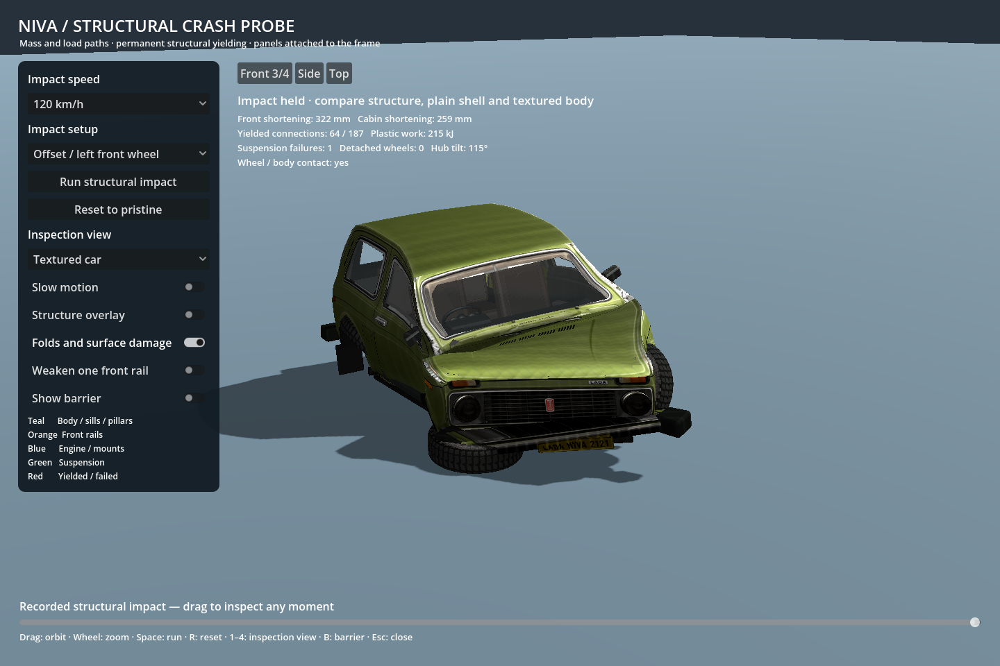

# car-sim-lowpoly

A small, reproducible Godot driving and crash example: **38 physical nodes → 39 render bones → a textured car with 39,673 render triangles**. Structural links yield permanently; the skeleton carries the large deformation; a shader adds smaller folds, normal detail and surface wear.



This isolated example includes the latest wheel revision: finite-width oriented wheels, independent hub tilt and rim spin, yielding/breakable suspension, limited tire compression and selective wheel-to-body load transfer. It includes the model, textures, editable Blender file, procedural model source and structural, wheel and driving verification suites.

## Start locally

Install the standard **Godot 4.7.2** build from [Godot's official release](https://github.com/godotengine/godot/releases/tag/4.7.2-stable). Python 3.10+ is only needed for the convenience runner and graph generator. Blender 4.5 is optional for model editing/rebuilding. No .NET, add-ons, package manager, external Jolt extension or network service is needed to run the example.

```sh
git clone https://github.com/RoniSaroniemi/car-sim-lowpoly.git
cd car-sim-lowpoly
python3 tools/demo.py run
```

On Windows use `py -3 tools/demo.py run --godot "C:\path\to\Godot.exe"`. On macOS the runner finds `/Applications/Godot.app` automatically. On Linux it looks for `godot` or `godot4` in PATH. Any platform can pass `--godot /path/to/executable` explicitly.

Alternatively, import `project.godot` into Godot and press **F6/F5**, then click **Run structural impact**. Opening the project alone does not auto-start an impact. The runner imports assets and starts a 120 km/h slow-motion offset crash automatically.

## Drive the same car

```sh
python3 tools/demo.py drive
```

W throttle, S brake, A/D steer, Space handbrake, Q forward/reverse, R repair/reset,
C camera, T live wheel-mount test, H/Y 60/120 km/h wall starts, U/I ±20° starts,
B baked/live crashes, and J/K low/high jump starts.
Hold W after a jump start. Two smooth ramps share their visual/contact surfaces.
The practice area uses the same car, wheels and damage state as the crash bench,
with [baked driving](docs/BAKED_DRIVING.md) enabled by default. That mode uses zero
deformation forecast calls or full structural solves, including after a bake.
Turn baking off to use [live adaptive simulation](docs/ADAPTIVE_SIMULATION.md).
The live tyre-grip and engine-power sliders keep their values through repairs.
Click **Three baked impacts** or run `python3 tools/demo.py drive-sequence` to
play 60 frontal → 60 at +20° → 120 at −20° on the same damaged car. Glass, seats
and the optional demo airbag are recorded too; playback performs no live cloth
or structural solves. Other damage histories need matching conditioned clips.

Both scenes use one [shared vehicle runtime](docs/SHARED_VEHICLE_RUNTIME.md).
Tune `vehicles/niva.json` or improve the shared dynamics/wheel code once, then
run both scenes and the combined checks. There is no duplicated driving chassis.

## Colosseum sandbox

```sh
python3 tools/demo.py arena
```

The alternative arena has tiered seating, repeating arches, a sand floor, sand/concrete/timber jumps, a halfpipe, and adjacent **42° / 24° ramps** with a straddling start. W/S/A/D, Space, Q and R keep their usual controls. Use **Open colosseum arena** in the test yard or **Open test yard** in the arena to switch locations; switching starts a fresh car. Both scenes use the shared vehicle runtime and current damage materials.

The arena uses sky ambient fill, material cavity shading and a shadowed sun. Its curved retaining wall uses cheap rigid contacts; it does not apply incompatible planar-wall crash recordings. See [arena controls, lighting, evidence and limits](arena/README.md).

```sh
python3 tools/demo.py verify-arena --no-import
```

## Try a baked crash

```sh
python3 tools/demo.py baked
```

Choose an impact angle and 60/120 km/h. The library covers the full circle every
30°, plus the two ±20° frontal cases and a 75°/60 km/h coverage case: 27 recordings. Space triggers contact-time
selection of the closest compatible bake; L records a fresh case; Z shows the
invisible 5 × 3 × 3 classifier grid. Buttons play the frontal trio or the whole bank.
Replay applies the saved deformation and wheel states with zero structural solver steps.
See [the round-trip procedure and limits](docs/BAKED_CRASH_PROBE.md).

## Candidate layered damage materials

The sandbox and baked/structural benches now share a persistent candidate surface treatment: impact-centred chipped paint and metal, peeling-edge shading, rough scuffs and cosmetic angular folds. It works with the existing crash bank, preserves earlier marks across the supported three-hit sequence, and clears on repair. The visual treatment remains open to art direction; integration is not final texture approval.

```sh
python3 tools/demo.py damage-studio
python3 tools/demo.py verify-surfaces
```

See [runtime ownership, clip compatibility, controls and rendered evidence](docs/DAMAGE_MATERIAL_INTEGRATION.md).

## Inspect the result

| Control | Action |
|---|---|
| 1 / 2 / 3 / 4 | Structure / plain body / textured body / ghost body |
| Space / R | Run selected impact / reset |
| Drag / scroll | Orbit / zoom |
| Replay slider | Scrub the recorded three simulated seconds |
| Structure overlay | Show or hide the simulated load paths |
| Local folds and surface damage | Compare structural geometry with and without shader detail |
| Weaken one front rail | Lower one side's strength and release the symmetry boundary |
| B / Escape | Show barrier / close |

Choose 20, 50, 80 or 120 km/h and either Full-width frontal or Offset / left front wheel. The offset case releases the symmetry boundary automatically. Switch inspection views after impact to compare the same state, rather than rerunning a different crash. Slow motion changes playback rate, not the physics timestep.

## Understand and reproduce it

1. [Local setup and verification](docs/SETUP.md)
2. [How the solver, skeleton and shader fit together](docs/ARCHITECTURE.md)
3. [Adapting the method to another car](docs/ADAPTING_A_CAR.md)
4. [Editable model and procedural rebuild](model/README.md)
5. [Validation scope and limitations](docs/VALIDATION.md)
6. [Wheel physics, suspension and contact setup](docs/WHEEL_PHYSICS.md)
7. [Shared runtime, driving and future dynamics](docs/SHARED_VEHICLE_RUNTIME.md)
8. [Adaptive simulation, recovery and ramps](docs/ADAPTIVE_SIMULATION.md)
9. [Driving with bakes and live tuning](docs/BAKED_DRIVING.md)
10. [Baked crash round trip](docs/BAKED_CRASH_PROBE.md)
11. [Snapshot provenance and asset rights](docs/PROVENANCE.md)

```sh
python3 tools/demo.py check
python3 tools/demo.py verify
```

The second command runs six structural cases, seven wheel cases, native skin binding, replay/reset, support/detachment checks, rigid-mount load checks, shared-runtime driving checks, adaptive wake/recovery, ramps, wheel retention and baked round-trip checks. Fresh reports go to `verification/structural_validation.json` and `verification/wheel_validation.json`. Fresh driving results go to `verification/driving_validation.json`. Checked-in handover reports record the earlier published revision; `verification/baseline.json` preserves the older pre-wheel reference for comparison.

## What is included

| Path | Purpose |
|---|---|
| `vehicles/niva.json` | Shared model/structure paths and dynamics tuning |
| `scripts/vehicle_simulation.gd` | Common runtime used by both scenes |
| `scripts/vehicle_dynamics.gd` | Steering, wheel torque, brakes and drag |
| `scripts/driving_sandbox.gd` | Driving input, camera and practice area |
| `structure.json` | Editable mass nodes and material/link properties |
| `scripts/build_structure.py` | Reproducible structural graph generator |
| `scripts/structure_solver.gd` | Fixed-step elastic/plastic XPBD-style simulation |
| `scripts/wheel_physics.gd` | Hub orientation, bearing spin, rounded tire contacts and knuckle yielding |
| `scripts/verify_wheels.gd` | Wheel-specific crash cases, contact ablation and detachment tests |
| `scripts/structural_skin.gd` | Native Skeleton3D binding and structural visualisation |
| `scripts/damage_surface.gdshader` | Compression-driven folds and material damage |
| `scripts/structural_probe.gd` | Test bench, camera, controls, replay and validation |
| `assets/` | Prebuilt GLB LODs, texture maps and source operation metadata |
| `model/` | Packed Blender source, build scripts and configuration |
| `docs/images/` | Actual screenshots from the included snapshot |
| `tools/demo.py` | Portable launcher; installs nothing |

## Scope

The custom graph owns the car's motion and 1,210 kg mass. Godot renders it. Jolt is selected in project settings, but **Jolt does not solve this deformable car**. Contacts are analytic floor/finite-box tests plus selected wheel-to-structure contacts. This is a driving/crash learning example with approximate game parameters, not a calibrated crash-engineering model.

Each wheel retains one translational mass node and adds rotational inertia, six suspension hardpoints and a yielding angular knuckle constraint. Detached wheels remain in the same solver and retain their velocity/spin. Tire response is approximate: it is not a pressure/sidewall simulation. General-world collisions, general body self-contact, body-panel separation, general panel tearing and a broader course remain future work. Mounted glass fracture/debris, front-seat flex and the optional demonstration airbag now run live and replay from baked state. Glass fragments use bounded floor/barrier collisions and add no car mass. Extreme folds can intersect. The complete example runs offline after dependencies are installed.

Code and documentation: [MIT](LICENSE). See [asset provenance](docs/PROVENANCE.md) for reference imagery and vehicle marks.
