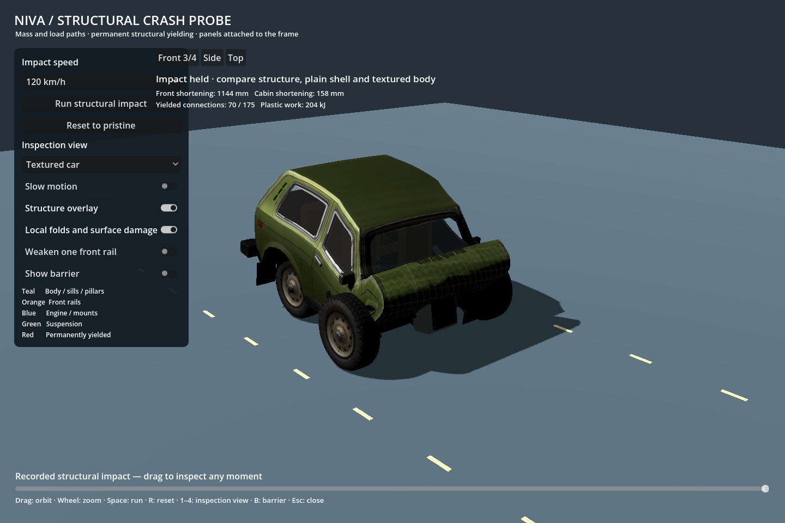

# car-sim-lowpoly

A small, reproducible Godot crash example: **38 physical nodes → 39 render bones → a textured car with 39,673 render triangles**. Structural links yield permanently; the skeleton carries the large deformation; a shader adds smaller folds, normal detail and surface wear.



This is an isolated snapshot of the validated structural probe. It includes the model, textures, editable Blender file, procedural model source and six-case verification. The later experimental wheel revision is deliberately outside this release.

## Start locally

Install the standard **Godot 4.7.2** build from [Godot's official release](https://github.com/godotengine/godot/releases/tag/4.7.2-stable). Python 3.10+ is only needed for the convenience runner and graph generator. Blender 4.5 is optional for model editing/rebuilding. No .NET, add-ons, package manager, external Jolt extension or network service is needed to run the example.

```sh
git clone https://github.com/RoniSaroniemi/car-sim-lowpoly.git
cd car-sim-lowpoly
python3 tools/demo.py run
```

On Windows use `py -3 tools/demo.py run --godot "C:\path\to\Godot.exe"`. On macOS the runner finds `/Applications/Godot.app` automatically. On Linux it looks for `godot` or `godot4` in PATH. Any platform can pass `--godot /path/to/executable` explicitly.

Alternatively, import `project.godot` into Godot and press **F6/F5**, then click **Run structural impact**. Opening the project alone does not auto-start an impact. The runner imports assets and starts a 120 km/h slow-motion crash automatically.

## Inspect the result

| Control | Action |
|---|---|
| 1 / 2 / 3 / 4 | Structure / plain body / textured body / ghost body |
| Space / R | Run selected impact / reset |
| Drag / scroll | Orbit / zoom |
| Replay slider | Scrub the recorded three simulated seconds |
| Structure overlay | Show or hide the simulated load paths |
| Local folds and surface damage | Compare structural geometry with and without shader detail |
| Weaken one front rail | Lower one side's strength and release the symmetry boundary |
| B / Escape | Show barrier / close |

Choose 20, 50, 80 or 120 km/h. Switch inspection views after impact to compare the same state, rather than rerunning a different crash. Slow motion changes playback rate, not the physics timestep.

## Understand and reproduce it

1. [Local setup and verification](docs/SETUP.md)
2. [How the solver, skeleton and shader fit together](docs/ARCHITECTURE.md)
3. [Adapting the method to another car](docs/ADAPTING_A_CAR.md)
4. [Editable model and procedural rebuild](model/README.md)
5. [Validation scope and limitations](docs/VALIDATION.md)
6. [Snapshot provenance and asset rights](docs/PROVENANCE.md)

```sh
python3 tools/demo.py check
python3 tools/demo.py verify
```

The second command runs the actual Godot simulation, verifies the native skin binding and checks replay/reset. Results go to `verification/structural_validation.json`. The checked-in `verification/baseline.json` is the original reference result; it is not substituted for a new test run.

## What is included

| Path | Purpose |
|---|---|
| `structure.json` | Editable mass nodes and material/link properties |
| `scripts/build_structure.py` | Reproducible structural graph generator |
| `scripts/structure_solver.gd` | Fixed-step elastic/plastic XPBD-style simulation |
| `scripts/structural_skin.gd` | Native Skeleton3D binding and structural visualisation |
| `scripts/damage_surface.gdshader` | Compression-driven folds and material damage |
| `scripts/structural_probe.gd` | Test bench, camera, controls, replay and validation |
| `assets/` | Prebuilt GLB LODs, texture maps and source operation metadata |
| `model/` | Packed Blender source, build scripts and configuration |
| `docs/images/` | Actual screenshots from the included snapshot |
| `tools/demo.py` | Portable launcher; installs nothing |

## Scope

The custom graph owns the car's motion and 1,210 kg mass. Godot renders it. Jolt is selected in project settings, but **Jolt does not solve this deformable car**. Contacts in this baseline are analytic floor and infinite-wall tests. This is a controlled frontal-crash learning example, with approximate game parameters, rather than a driveable vehicle or calibrated crash-engineering model.

Wheels are mass nodes with spherical contact proxies and yielding supports in this snapshot. General-world collisions, realistic spinning wheel assemblies, self-contact, structural separation, glass debris, sheet tearing and integration with the driving sandbox remain future work. Extreme folds can intersect. The complete example runs offline after dependencies are installed.

Code and documentation: [MIT](LICENSE). See [asset provenance](docs/PROVENANCE.md) for reference imagery and vehicle marks.
