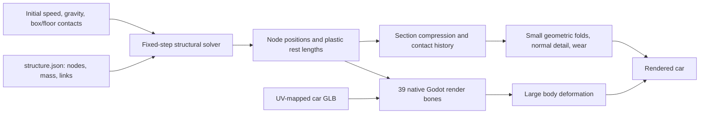

# Architecture: physical graph → skeleton → surface detail

## Three representations of the same car

The physical representation is deliberately small. Mass-bearing points and compliant connections determine load propagation. The render representation is a much denser skin driven by those points. The damage material provides fine detail that would be expensive and unnecessary to solve as physics.



A physics node is a point with mass, position and velocity. A render bone is a transform uploaded to Godot's skinning system. Here, most render bones follow physics nodes directly, but the two concepts are not interchangeable. An additional render bone keeps the engine geometry coherent around its physical cluster.

The GLB is loaded without needing a pre-authored crash armature. `structural_skin.gd` constructs the Skeleton3D/Skin and weights at startup.

## Structural layout and mass

The generator builds seven four-corner sections along +X. Each has two lower and two upper nodes, with the lower nodes carrying most of the section mass. Adjacent sections connect through rails, sills, roof members and cross-bracing. The current graph has 187 links, including 24 suspension/steering/upper-arm connections. Four additional angular knuckle constraints live in the wheel module. Longer links add bending support. Some braces stand in for distributed shell/panel stiffness; they are not literal tubes in the real vehicle.

| Node indices | Meaning | Mass |
|---|---|---|
| 0–27 | Seven body sections, four nodes each | 935 kg total |
| 28–29 | Auxiliary A-pillar/roof nodes | 5 kg total |
| 30–33 | Stiff four-node engine cluster | 190 kg total |
| 34–37 | Four wheel centres, each with an oriented assembly and bearing spin | 80 kg total |

Total: **1,210 kg**, counted once. There is no extra rigid chassis mass running in parallel. Engine mounts can yield; engine-cluster links are much stiffer. Roof/pillar/sill strengths remain finite, allowing the passenger compartment to deform under a severe load.

Coordinates in the runtime and graph are metres, +X forward, +Y up and Z across the car. Positive-Z is the source model's left side. Blender source is +X forward, +Z up; GLB export performs the axis conversion.

## Fixed-step integration

`structural_probe.gd` accumulates elapsed simulation time and feeds `structure_solver.gd` a fixed **1/480 s** timestep. Each step performs eight alternating constraint sweeps:

1. Save old positions, apply gravity and predict positions from velocity.
2. Clear each connection's per-step Lagrange multiplier.
3. Solve elastic/plastic distance and anchored suspension constraints, angular knuckle constraints, box/floor contact and selected wheel/body contact.
4. In the full-width baseline, impose the declared mirror-symmetry boundary.
5. Reconstruct linear/hub angular velocities, resolve contact friction and rim spin, apply connection damping, and remove suspension links whose overload persists beyond their configured threshold.
6. Record diagnostics; retain changed plastic rest lengths for subsequent steps.

At Godot's 120 physics ticks per second, normal playback supplies roughly four structural substeps per tick. Slow motion supplies less simulation time, retaining the same substep size. Constraint sweep order alternates to reduce a consistent directional bias.

This is an XPBD-style game solver inspired by compliant position constraints. It is not a full finite-element shell solver or a complete reproduction of every method in the XPBD paper.

## One elastic/plastic connection

For endpoints `a` and `b`, distance `d`, current rest length `L`, stiffness `k`, timestep `h`, inverse masses `wa`, `wb`, and accumulated multiplier `lambda`:

```text
C = d - L
alpha = (1 / k) / h²
delta_lambda = (-C - alpha * lambda) / (wa + wb + alpha)
force_estimate = abs(lambda + delta_lambda) / h²
```

The solver moves the two endpoints along the connection direction according to their inverse masses. If the estimated force exceeds the connection's yield limit, the rest length changes within configured compression/extension bounds. This creates permanent deformation after the external load is gone. Hardening increases the yield threshold as plastic change accumulates. Tension receives a separate multiplier in this implementation.

Damping reduces relative velocity along a connection. It does not represent all the mechanisms of real crash-energy dissipation. `plastic_work` is a useful diagnostic based on yield force times plastic rest-length change, not a closed or experimentally calibrated energy ledger.

| JSON property | Meaning / unit |
|---|---|
| `mass_kg` | Node's share of vehicle mass, kg |
| `radius_m` | Node's floor/wall contact radius, m |
| `stiffness_n_per_m` | Axial connection stiffness, N/m |
| `yield_n` | Baseline permanent-deformation threshold, N |
| `max_compression` / `max_extension` | Allowed plastic rest-length fractions |
| `damping_ns_per_m` | Axial damping coefficient, N·s/m |
| `hardening` | Global strength increase with accumulated plastic deformation |

Use the generator's member groups to tune a load path rather than changing arbitrary render vertices. Small initial rail/floor curvature selects a repeatable buckling direction without authoring a finished crash shape.

## Contact and symmetry scope

Contact is analytic against a floor at **y = 0** and a finite static box. Full-width frontal uses box bounds `(0,0,-2.25)` to `(0.5,3.5,2.25)`; offset mode uses `(0,0,0.48)` to `(0.65,1.35,1.10)`. These match the visible barrier geometry. Hiding the barrier changes visibility only.

Structural nodes use small spherical proxies. Wheels use an orientation-aware rounded shape with finite width, compliant tire contact and a hard compression limit. Three configured capsule segments per wheel represent nearby sill/firewall/upper structure. Contact pushes both the wheel and the structural segment, so it can change permanent deformation. There is still no general body-to-body or panel self-contact. See [wheel physics](WHEEL_PHYSICS.md) for the shape, ownership and configuration details.

The full-width case mirrors paired points to stop tiny asymmetries choosing an arbitrary yaw direction. That is an explicit test boundary, not a universal stabilisation technique for game driving. Weak-rail and offset modes release symmetry. Failed wheel supports also release their mirror pairing so detached wheels do not retain an invisible symmetry tether. Validation compares strong and weak versions with symmetry released in both, so it does not attribute a changed boundary condition to strength alone.

Godot/Jolt is configured but does not own the deformable car. Adding Jolt world collisions later requires exchanging contact impulses or moving to a unified collision/solver ownership scheme; a second full-mass chassis must not absorb the same impact independently.

## Skeleton binding

At startup, each mesh is transformed into the shared car coordinate system. UVs, materials, normals and tangents are retained. Selected deformable panels receive longest-edge subdivision once at load time, bringing the render example to **39,673 triangles**. The physics graph remains 38 nodes.

Body vertices receive up to eight influences from the surrounding two structural sections: interpolation along X, then across the section's height and width. Weights sum to one. Wheel meshes bind rigidly to their wheel node; their bone rotation is the hub orientation composed with the separate bearing spin. Selected engine-region interior vertices bind to the extra rigid engine render bone.

Each frame:

- Section directions form local orthonormal frames; these supply bone rotations.
- Node positions supply bone translations.
- The engine cluster supplies its own rigid frame.
- Godot skins the mesh using the native Skeleton3D/Skin relationship.

All bones are roots in this example's common skeleton space. `set_bone_pose_position` receives the actual position in that space, not a displacement from the rest position. The Skin stores the inverse bind relationship. Subtracting the rest position again produces an incorrect deformation. See the included `binding_quality()` checks for anchor and weight errors.

Bare-structure rendering hides numerical braces that would obscure interpretation. Hiding a brace changes only its visibility; the physical connection continues to participate.

## Damage shader

`damage_surface.gdshader` layers detail onto the skinned result:

| Input | Purpose |
|---|---|
| UV | Existing base colour, tangent normal and roughness maps |
| UV2 = rest `(x, z)` | Stable car-local coordinates so procedural creases stay attached to material |
| Vertex colour alpha | Fold eligibility mask, strongest on selected upper metal panels |
| `plastic_sections[7]` | Despite the name, currently a geometric section-compression signal |
| `contact_sections[7]` | Coarse contact-history signal from structural nodes |

The large wreck shape comes from the skeleton. Small coherent folds displace the shader's vertices along Y, with a maximum coefficient of 0.022 m multiplied by local compression, mask and envelope. Fine wrinkles perturb tangent-space normals; compression and contact alter roughness and restrained paint wear.

The shader's compression arrays are not a measured per-triangle metal strain field. They are interpolated longitudinal signals; left/right damage localisation remains coarse. Shader displacement is not fed back into collision. Disabling detail preserves the structural deformation, which is why that toggle is useful during review.

Plain-body mode suppresses the texture normal map and displays a neutral surface while retaining the structural deformation and optional shader folds. To inspect only the skeleton-driven shape, disable Local folds and surface damage as well.

## Replay and physical limits

Recorded frames retain positions, node damage/contact and connection rest lengths/damage. The slider interpolates positions between frames for inspection. This is recorded playback, not a saved solver state from which arbitrary simulation continuation is guaranteed.

The run stops after three simulated seconds and holds its state. Fine tearing, detached body panels, glass particles, general collision geometry and general body self-contact remain absent. Wheel rotation and wheel detachment are included, with the limitations described in the wheel guide. The shape and material constants are hand-tuned game approximations.

## Primary references

- Macklin, Müller and Chentanez, [XPBD: Position-Based Simulation of Compliant Constrained Dynamics](https://matthias-research.github.io/pages/publications/XPBD.pdf), 2016 — compliant constraints and force estimates.
- Godot [Skeleton3D](https://docs.godotengine.org/en/stable/classes/class_skeleton3d.html) and [Skin](https://docs.godotengine.org/en/stable/classes/class_skin.html) — native render binding and skeleton-space pose conventions.
- Godot [Using Jolt Physics](https://docs.godotengine.org/en/stable/tutorials/physics/using_jolt_physics.html) — built-in engine selection. This project's custom crash solver has separate ownership.
- BeamNG [beams](https://documentation.beamng.com/modding/vehicle/sections/beams/) and [flexbodies](https://documentation.beamng.com/modding/vehicle/sections/flexbodies/) — useful comparisons for structural and visual representations; no BeamNG code or vehicle files are included.
