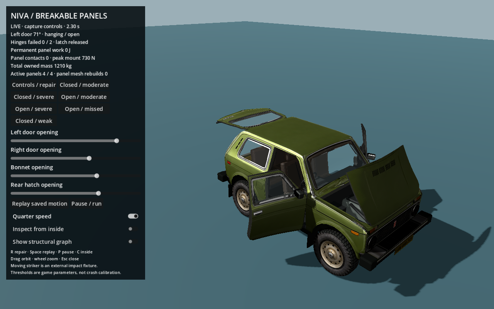
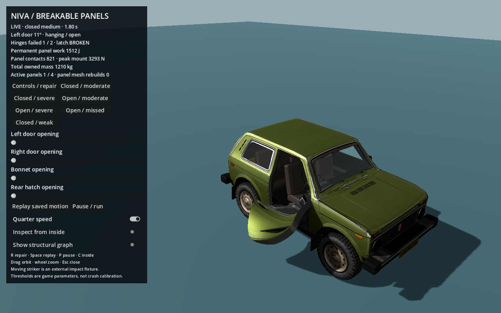
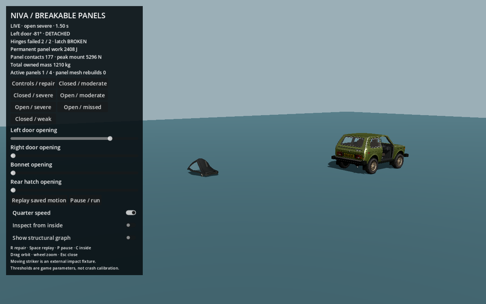

# Opening, bending and breakable panel probe

This isolated probe reuses the actual operational Niva asset. Both front doors, bonnet and rear hatch can open and close under bounded actuators. A ten-particle cage makes each moving panel deformable. Separate latch and hinge constraints can fail, leaving a door hanging on one hinge or completely detached. The shared production sandbox, GLB and existing crash banks are unchanged.





## Run

From this worktree:

```sh
/Applications/Godot.app/Contents/MacOS/Godot --path . res://probes/panels/probe.tscn

# Seven real simulation cases, controls, ownership, rendering binding and replay:
/Applications/Godot.app/Contents/MacOS/Godot --headless --path . \
  --script res://probes/panels/verify.gd

# Native screenshots, exact paused physics states:
/Applications/Godot.app/Contents/MacOS/Godot --path . \
  res://probes/panels/probe.tscn -- --capture-panels

# Matched native intact rendering counters and CPU pose upload:
/Applications/Godot.app/Contents/MacOS/Godot --path . \
  --script res://probes/panels/benchmark.gd
```

The opening sliders command the two doors, bonnet and rear hatch. Case buttons stage controlled moving-striker impacts with the left door closed or already open. R repairs and returns to controls; Space replays saved motion; P pauses; C inspects the inside. Drag or scroll to inspect. The normal view starts at quarter speed. The controls recording retains the latest four seconds, bounding memory use. Replay is inspection; R or a case button starts a new live test. A damaged panel rejects actuator commands rather than snapping closed or healing mounts.

These are external kinematic-striker experiments, not a driving scene. The visible orange striker supplies work. Opening actuators also supply bounded work. Different stroke distances and velocities are explicitly controlled fixtures; the case names are not calibrated speed-to-failure predictions.

## The operational version was already in the repository

`assets/Niva_2121_LOD0.glb`, SHA256 `930f43ec759d404f642b7ec4da8adc5ea65ca99fa14da58c14366dee5a7815ae`, is byte-identical to the earlier `niva-godot-sandbox/assets/Niva_2121_LOD0.glb`. It has 38 glTF nodes, four `Hinge_*` parents and a four-channel `Panels_Open_Close` animation. The older standalone `lada-niva-game-asset` model has ten nodes and no opening animation; it is not the operable source.

| Source control | Actual moving render children | Source opening |
|---|---|---:|
| `Hinge_Door_Left` | Two `Panel_door_left_*` meshes plus `Glass_Door_Left` | +72° |
| `Hinge_Door_Right` | Two `Panel_door_right_*` meshes plus `Glass_Door_Right` | −72° |
| `Hinge_Bonnet` | Two `Panel_bonnet_*` meshes | 72° |
| `Hinge_Tailgate` | Two `Panel_tailgate_*` meshes plus `Glass_Rear` | 95° |

The source builder consolidated handles, mirrors, inner door trim and armrests into their parent panel's material groups. The second panel mesh already has an inward skin, opening edges and backing thickness. No body extraction, GLB rebuild or second car model was needed. The normal crash skin deliberately flattens these groups onto its body skeleton and removes the source animation player; this probe replaces that panel binding while retaining the other body/wheel meshes.

Coordinate conversion follows `assets/vehicle_controls.json`: Blender `(x,y,z)` maps to runtime `(x,z,-y)`. Door axes are runtime +Y with opposite opening signs. Bonnet/hatch source axes are runtime −Z. Render vertex positions, UVs, normals, tangents and inner vertex colours are preserved through the probe's binding/refinement.

## Rig and simulation

`panel_skin.gd` subclasses the existing native structural skin. The body/wheels retain their normal 39-bone skeleton. Each moving panel has a ten-bone local skeleton driven by its own cage: nine controls in a fitted 3 × 3 panel surface plus one interior depth control. Four nearby controls influence each render vertex. Grid axes follow the source panel shape and hinge; door upper-front geometry slopes with the actual window frame. Glass, mirror and trim geometry uses that same panel skeleton, so opening does not leave those parts on the chassis or apply a second hinge transform.

The actual transform chain is represented by world-space particles and constraints:

```text
deforming chassis mount targets → hinge/latch constraints → cage motion and plastic bending
                                                        → native panel skin and attachments
```

The ten controls carry distributed mass and elastoplastic distance/bending support. Structural mount targets use the shared eight-weight `car_attachment.gd` map, so pillar/body movement changes the door's support. This is not one rigid pristine door rotating over a crushed cabin. Plastic edge lengths persist after unloading. A remaining point hinge lets a damaged door sag/swing under gravity; two surviving coaxial mount points define its primary hinge axis. The one-hinge state is a coarse ball-joint-like damaged mount, not a complete bearing/bushing model.

`panel_graph.gd` extends the existing structural solver only inside this probe. Panel integration occurs before its normal step; the panel constraints participate inside the same eight body/contact sweeps; the shared solver then reconstructs body velocities. Mount corrections move both cage and weighted chassis nodes. This gives reciprocal force transfer without a second full-mass chassis.

### Mass ownership

The sample panel masses are chosen game values: 25 kg per front door, 18 kg bonnet, 22 kg hatch. They are not measured factory values. They are already part of the original 1,210 kg.

- Initial closed/intact panels are **condensed into the original chassis mass**, with no active panel mass or cage solve.
- Opening or imminent local contact extracts that panel's configured mass from substantial nearby lower-body nodes and activates its ten mass points.
- The transfer corrects core linear/angular velocity so combined linear/angular momentum is preserved. Tiny roof nodes are not used as mass donors.
- After release, mass is already in the cage; breaking constraints neither creates a rigid body nor changes mass/velocities.
- The mass ledger sums current body-node masses plus active panel masses; it stays 1,210 kg. A second opposite-door hit does not reset a previously released door.

A conservative quiet recondensation hook requires a completely undamaged, latched panel with a very close pose/velocity fit to the chassis. The ordinary open/close regression does **not** meet that fit threshold by its final sample, so those recently opened panels remain awake. Initial closed driving is cheap; robust damage-preserving sleep after an arbitrary open/close cycle remains work before production integration. R explicitly repairs and restores the initial condensed state.

### Failure and contacts

Latch engagement is delayed until the closing panel is near alignment and has low angular speed. This avoids ordinary actuator closing breaking its own latch. Damaged latch/hinge flags are irreversible until repair. The latch is a separate compliant constraint; it can release while hinges remain. The lower hinge is deliberately weaker in this illustrative profile, allowing a one-hinge sag case under the same material settings used by all fixtures.

| Property | Probe value |
|---|---:|
| Upper hinge force threshold / delay | 3,800 N / 12 ms |
| Lower hinge force threshold / delay | 2,280 N / 8 ms |
| Latch force threshold / delay | 1,300 N / 12 ms |
| Hinge attachment stiffness | 500,000 N/m |
| Latch attachment stiffness | 80,000 N/m |
| Cage main / bending-support stiffness | 85,000 / 18,000 N/m |
| Cage main / bending yield scale before hardening | 1,500 / 450 N |

Failure uses actual accumulated constraint-load exposure, not vehicle speed or a preset animation command. The faster closed fixture can retain its hinges while the open fixture detaches: leverage and contact path matter.

Panel probes have finite-radius point envelopes and relative swept expanded-box contacts against the visible moving striker, plus floor contact. These are not triangle collisions or a general Godot-world collision adapter. The striker reverses after its defined stroke; it does not continue through the car and accidentally strike the opposite door. The weak reference has a short, approximately 10 mm contact stroke. Ground friction is intentionally simple.

The source model's manufactured door gaps remain. No new fracture cut, mesh swap, cap or render-resource allocation occurs at hinge release. The same mesh, skin, points and velocities continue, so there is no release-pose pop. Inner skin/edge thickness was already part of the moving source panel.

## Results and visual evidence

The final focused suite passes **78 checks**. Seven simulation cases run to 2.5 seconds at 480 Hz and save 301 frames at 120 Hz.

| Case | Measured result |
|---|---|
| Intact closed | Zero panel cage steps, no failures; exact shared body trajectory relative to the unmodified solver |
| Weak closed contact | Contact occurs; latch/hinges retained; no permanent cage change |
| Closed moderate strike | Latch fails at about 0.273 s; lower hinge fails at about 0.279 s; upper hinge retains a visibly bent/hanging door |
| Closed severe strike | Latch fails, hinges retain; not an automatic speed-based ejection |
| Open moderate strike | Actual open-door collision; about 33 mm maximum permanent cage-edge change; hinges retained |
| Open severe strike | Both hinges fail; complete release around 0.1104 s; about 263 mm maximum permanent cage-edge change |
| Missed open strike | No panel contacts or damage; opening stays controlled |

The source materials and topology are visible in [intact closed](../probes/panels/evidence/intact_closed.png), [all panels open](../probes/panels/evidence/intact_open.png), [inside the open door](../probes/panels/evidence/inside_open.png), [closed impact deformation](../probes/panels/evidence/closed_deformed.png), [one-hinge hang](../probes/panels/evidence/closed_latch_hang.png), [open-door impact](../probes/panels/evidence/open_strike_hang.png), [just released](../probes/panels/evidence/open_separation.png) and [independent aftermath](../probes/panels/evidence/detached_aftermath.png). These are actual native Godot captures, reviewed visually. They are not generated illustrations or retouched mockups.

[Intact comparison](../probes/panels/evidence/intact_comparison.png) shows the original structural skin at left and the articulated skin at right, using identical rest pose/camera/light. It is a static intact comparison; it does not claim a full ramp/body-flex fidelity test for this isolated panel probe.

Verification also checks all four opening/closing controls and angle limits, positive node masses, momentum-preserving activation, zero pose/velocity/momentum change at the release event, refusal to heal damaged panels by controls, native skin weights/anchors, panel-owned glass, removal of every panel anchor after full release, a second hit retaining the first detached door, and exact disk replay of body/panel poses and latch/hinge flags with **zero solver steps**. The shared `python3 tools/demo.py verify --no-import` regression also passed unchanged.

## Performance and saved state

The initial dormant panel physics gate measured about **1.65 µs per call** on the local Apple M3. Native matched closed rendering has **25 draw calls and 39,673 triangles in both versions**. The panel rig adds forty bones: CPU pose/map/upload calls measured approximately 247 µs versus 33 µs for the original skin. This extra CPU work is real; equal draws do not mean equal rendering cost.

Whole body plus one active panel authoring calls averaged roughly 3.7–4.0 ms per 480 Hz step in the focused run, versus about 3.0 ms for the closed reference. These are live authoring timings, not intended game playback costs. Release bookkeeping measured roughly 33–40 µs; the separate first-release whole-step sample measured about 3.86 ms. Existing render resources are retained through detachment. Native GPU timestamps returned zero/unavailable, so no GPU-time or whole-game FPS claim is made. Exact measured data is under `probes/panels/evidence/{validation,native_budget,release_budget}.json`.

`probes/panels/data/open_severe.panelclip` is an actual compressed disk recording (~2.4 MB) used by verification. Version-1 probe snapshots include active/condensed mass ownership, world cage positions/velocities, plastic edge state, latch/hinge flags, target/angle, stable fracture event IDs and body states. Replay restores them without solving. It is intentionally a verbose checkpoint format, not a finished production bake contract.

## Main-integration path and limits

1. Promote panel ownership under the existing shared effects/part lifecycle, rather than adding another whole-car solver. The physical panel mass must be reserved from the main graph/compact aggregate before active integration; cosmetic-only controllers must not claim that mass too.
2. Retain the deforming mount → hinge/articulation → cage representation. Profile hinge axes, stops, latch location, materials, mass/inertia and supports per panel/car. Closed compact driving should keep the current cheap aggregate path and lazy panel activation.
3. Bind door/rear glazing to the panel mount provider. In this probe, actual pane meshes follow the moving/deforming panel correctly, but the shared glass membrane/fracture controller is **not running**; existing main glass/interior effects are not duplicated. Production needs a panel-local mount adapter for glass events/debris and attachment/component lineage. Seats remain attached to the body.
4. Add general registered-world contact, edge/segment coverage for objects between sparse control points, panel-to-body/frame contact and better remaining-hinge angular support. Existing bounds/floor/striker contacts are adequate for these controlled cases, not arbitrary doors hitting traffic or scenery. Open panels currently require the probe's visible striker adapter; they are not integrated into the main sandbox wall sensor.
5. Extend the current conditioned state descriptor with panel active/attached/latch/hinge flags, permanent cage state and stable part identity. Record attachment-local continuous states plus discrete ownership/failure events. Avoid repeating immutable edge/binding dictionaries and untouched panel positions in every production frame.
6. During later baked impacts, animate only owned affected panels and preserve previously detached panel world motion, just as main currently preserves old detached wheels. The current main player/selector does not yet understand this probe's panel snapshots. Integrating panel states requires rebuilt records and explicit damaged-state compatibility, not stacking a pristine opening animation over a damaged door.
7. Keep the full live cage/body solver for probe authoring and active impacts. Production baked playback should restore panel bones/state and run only bounded detached-object/world response, without waking body/cloth/airbag solvers.

Bonnet and hatch use the same deformable cage and load-failure code, and their open/close controls are tested. Dedicated bonnet/hatch impact-failure fixtures are not part of this first deliverable. The left door has the full impact evidence; the right door is exercised through controls and the second staged strike. There is no arbitrary sheet tearing, new body cut, glass shattering, panel self-contact, validated factory strength or complete main-sandbox integration in this probe.
