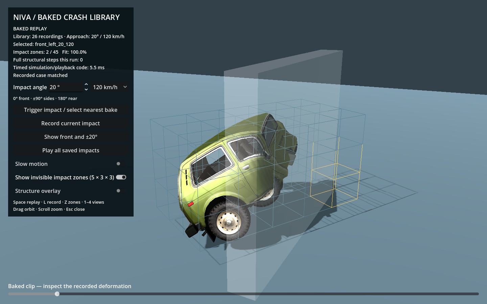

# Baked crash library and contact-time selection

The probe records the whole structural vehicle and its wheels, then selects the best compatible recording when an impact occurs. Rendering uses the same skeleton, textures and damage shader as the live solver. The probe is separate from free driving.

## Run and reproduce

```sh
python3 tools/demo.py bake
python3 tools/demo.py verify-baked --no-import
python3 tools/demo.py baked --no-import
```

The saved library contains **26 recordings**:

| Cases | Speeds | Recordings |
|---|---|---:|
| Full circle, every 30° | 60 and 120 km/h | 24 |
| Additional +20° and −20° frontal approaches | 120 km/h | 2 |

0° faces the wall front-first; +/−90° presents either side; 180° presents the rear. Positive headings rotate the nose toward driver-left. Every case is a controlled **wall-normal slam**: the car is rotated to the specified heading, then launched along world +X into the same stationary finite barrier. This isolates impact direction without requiring a car to drive sideways or backwards under power. The wheel bearing speed is initialized from the component of launch velocity along the car. These are horizontal impact directions; roof drops and vertical angles are not included.

The entire existing 38-node graph is deformable: front/rear rails, floor, cabin pillars/roof, engine mass and wheel assemblies. Oblique, side and rear cases disable the frontal symmetry boundary. No new restriction keeps deformation confined to the front. This remains a coarse structural graph, with the existing skin/shader supplying smaller visual folds; it is not sheet-metal FEM or general body self-contact.

## Interactive inspection

Choose an angle and 60/120 km/h, then click **Trigger impact / select nearest bake** or press **Space**. The approach angle may differ from every recording: e.g. 5° chooses frontal, while +17° and −17° choose the corresponding 20° case. Selection happens at contact, from the measured impact signature; the UI does not pass a clip ID to the classifier.

- **Show front and ±20°** plays the three initial cases in sequence.
- **Play all saved impacts** cycles through the full library.
- **L / Record current impact** runs the live solver and saves/replaces that angle/speed case.
- **Z** reveals the normally invisible 5 × 3 × 3 impact grid; struck cells are orange.
- The slider scrubs the selected replay after contact. Drag or scroll to orbit/zoom.
- Slow motion changes presentation speed; live recording still solves at 480 Hz.
- Structure overlay and 1–4 inspection modes work in either path.

For automatic launch:

```sh
godot --path . res://baked_probe.tscn -- --demo-three
godot --path . res://baked_probe.tscn -- --gallery
godot --path . res://baked_probe.tscn -- --angle=90 --speed=60
```

## Recording format and ownership

`crash_bake_recorder.gd` uses the shared full solver, registers the first conservative probe-contact event, and captures 2.5 seconds after it. `baked_crash_clip.gd` saves **301 states at 120 Hz** per recording in compressed Godot Variant files under `bakes/`. Each has readable JSON metadata, and `bakes/library.json` indexes the bank. The catalog can be regenerated with `python3 tools/demo.py index-bakes --no-import` without re-simulating.

Recorded states include all structural node positions/velocities, link plastic lengths/damage and broken flags, shader damage/contact values, and wheel hub orientation, bearing spin, compression and detachment state. Source fingerprints identify the runtime inputs used to create a recording. The approach prepares the suspension. At the recording boundary, a uniform velocity change initializes the car at exactly the requested wall-normal 60/120 km/h; relative suspension velocities are preserved and wheel spin is initialized to the forward component. Metadata records this normalization and the preparation speed separately. Thus pre-contact lateral tire friction does not silently lower the advertised impact speed.

`impact_zone_grid.gd` bins the first touching probes in **car rest space**, with the impact normal expressed in the car's current frame. Each event includes mass-weighted zones, local normal, incident speed, momentum and energy proxies. A separate per-zone history records contact substeps and nodal momentum-loss proxies. The grid is a classifier; it adds no extra collision bodies.

## Runtime matching and playback

`baked_crash_player.gd` starts every approach from a common frontal reference pose for that speed, rotated to the requested heading. It moves that pose kinematically and sweeps against the barrier. At first contact it scores every recording using:

- 70% angular similarity, with a 15° Gaussian scale;
- 20% weighted zone Jaccard overlap;
- 10% similarity of incident momentum proxies.

Compatibility requires angle error below 18.01°, zone overlap above 0.1, incident momentum ratio between 0.85 and 1.15, and score above 0.65. The severity interval keeps the 60/120 bins separate; speeds between bins can be rejected. These are probe parameters, not calibrated equivalence bounds. Incompatible events are rejected instead of forcing a recording.

The selected trajectory is translated to the contact anchor and yaw-aligned with the incoming car. Small differences between the incoming and recorded first pose blend out over 0.10 seconds. Wheel spin phase is registered continuously; hub pose corrections use the same short transition. After that transition, the replay exactly follows the registered recording. Between saved frames, positions/damage and wheel rotations/spin interpolate. Broken-link and release flags change on their recorded sample.

The player calls **zero structural or suspension solver steps** throughout approach, playback and scrubbing. All recorded root motion and wheel trajectories are replayed. A detached wheel is consequently a baked trajectory during this probe, rather than a newly spawned live physics body.

## Verification and limits

`verify_baked_roundtrip.gd` checks a fresh local live recording through disk serialization and replay. It does not require live floating-point physics on another platform to be bit-identical to the published recordings. `verify_crash_library.gd` checks all saved cases for correct contact-time selection, source fingerprints, every authored pose/damage/wheel sample, discrete damage state, continuous handoff, final registered deformation and zero actual solver steps. It also tests unrecorded frontal angles and all 15° halfway directions at both speeds, and rejects incompatible severity and empty contacts.

The [saved local results](BAKED_CRASH_RESULTS.md) include all 26 selections and the 264-check result.



Fresh reports: `verification/baked_roundtrip_validation.json` and `verification/crash_library_validation.json`. `python3 tools/demo.py capture-baked --no-import` produces GPU screenshots. Numerical agreement establishes fidelity to the recording, not crash-engineering accuracy. Timings in the reports exclude rendering, skin updates, setup and file I/O, and should not be read as whole-game frame-rate gains.

Intermediate-angle playback is an approximation: registration can rotate the recorded barrier interaction relative to the real wall, and does not re-solve contact. Secondary collisions, arbitrary obstacles, blending speed bins, continuing live driving after playback, independently live detached wheels, glass and panel debris remain future integration work. Extreme folds can visibly intersect as in the source solver. Momentum/energy values and nodal momentum-loss histories are explicitly proxies, not calibrated wall forces.
