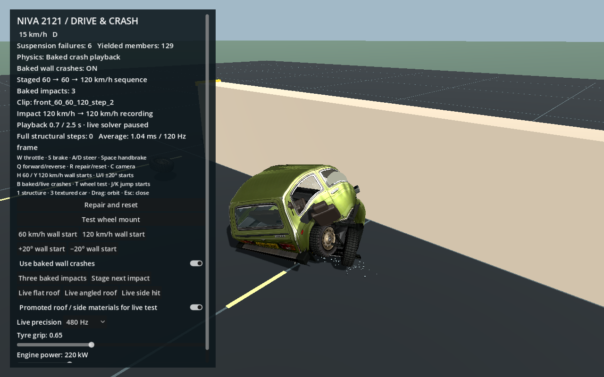

# Drive with baked crashes and live tuning

```sh
python3 tools/demo.py drive
```

The sandbox starts with **Use baked wall crashes** enabled. Drive normally with W/S and A/D. At an imminent compatible wall contact, the same car graph changes from lightweight driving to a recorded crash, then returns to lightweight physics with its damaged body shape, suspension and detached-wheel state retained.

| Control | Action |
|---|---|
| W / S / A / D | Throttle / brake / steer |
| Space / Q | Handbrake / select forward or reverse |
| R | Repair, reset and rearm the next bake |
| H / Y | Stage a 60 / 120 km/h approach; driving controls remain usable |
| U / I | Stage the +20° / −20° 120 km/h approaches |
| B or the checkbox | Switch baked crashes on/off |
| J / K | Stage either jump ramp |
| C / drag | Change camera / orbit |
| Three baked impacts | Stage 60 frontal → 60 at +20° → 120 at −20°, retaining damage |
| Stage next impact | Reposition/relaunch the damaged car for its next supported transition |

Tyre grip adjusts the actual wheel friction coefficient from 0.10 to 1.50. Engine power adjusts from 55 to 660 kW and scales the profile's peak torque in proportion, so the change is useful at low speed too. Both sliders act immediately and survive R/repair. They are session tuning; the vehicle profile and baked files are not rewritten. Sliders affect live driving, suspension and contacts; a playing crash keeps its authored trajectory. The existing 160 km/h profile speed taper remains unchanged.

## Baked mode ownership and performance

`driving_vehicle.gd` extends the shared `vehicle_simulation.gd` and owns the switch. The scene remains input, level, camera and UI. There is one 1,210 kg vehicle graph; no second physics chassis is spawned.

With baked mode **on**, the legacy deformation forecaster and full structural solver are never called. The body/engine mass stays in the existing rigid aggregate during driving, including ramps and the period after a crash. Wheels retain the existing 120 Hz suspension, rotation, friction and breakable mounts. Simple generalized contact impulses keep the rigid/deformed body above the analytic terrain and outside the test barrier. These contact projections do not evaluate the 187 structural deformation constraints.

A cheap distance check rejects remote obstacles. Near the wall, a 66 ms nodal prediction runs at most 30 Hz and arms 50/100 mm classification bands. Only an **unpadded actual contact within the next 120 Hz step** can trigger playback; the predictor never runs the structural solver. A missed/cleared prediction cancels. Detached wheels do not define the car impact footprint. This sensor has separate counters from the older live deformation forecaster. The bank is loaded once and shared, not read from disk during a crash. The nearest 60/120 km/h speed bin is selected first; the existing zone/local-normal classifier then chooses an angle within that bin. Impacts from 35 to 175 km/h are eligible. There is no interpolation between severity bins; an 80 km/h hit can use the 60 km/h recording.

The existing player binds to the **same live graph** through a weak reference. A 0.10-second Hermite registration preserves contact pose and initial node velocity while blending onto the recorded trajectory. Wheel spin phase is continuous. No full structural or suspension solve runs during playback. Simulation time stays monotonic.

At completion, retained link lengths, damage, broken supports, wheel alignment/spin and detached states become the lightweight simulation's current state. Constraint accumulators are cleared; the damaged body is captured as a rigid shape, and detached wheels keep moving with coarse collision physics. No full-solver wake happens after the clip.

The standard bank describes pristine vehicles. After a crash, a separate **conditioned transition bank** matches the current body shape, plastic lengths, failed links, wheel attachment/alignment, glass tears and seat/airbag state before selecting another clip. The first supported history is **60 km/h frontal → 60 km/h +20° → 120 km/h −20°**. Prior damage is retained; absolute pristine clips are never stacked onto a damaged car. Previously detached wheels keep their world motion during subsequent playback. Low-speed bumps, unsupported damage histories, airborne/tilted poses, wall corners/short faces and incompatible events use rigid contact response in baked mode. They do not silently activate live deformation. The **Three baked impacts** button demonstrates that bounded history at half speed. It repositions/relaunches the attached damaged car between impacts; it is an explicit fixture, not three independently driven laps. **Stage next impact** performs one supported staging operation after a normal first crash. Natural subsequent contacts use the same state/contact selector. R repairs everything.

Turn baked mode **off** to use the existing forecast-driven full solver instead. The wheel-mount test selects live mode explicitly. A toggle during playback affects the mode used after the current clip completes.

This is still the benchmark's analytic terrain and finite barrier, not arbitrary Godot-world collision. Registered intermediate-angle clips can approximate contact rather than exactly satisfy the wall. Replaying an authored crash does not produce a newly calibrated physical outcome for every speed, grip setting or glancing trajectory.

## Live effects and authoring precision

All six actual glass panes and the two extracted front-seat groups share the car graph. Laminated windscreen cracking/retained-sheet tearing, tempered-pane fragments, seat hinges and an optional demonstration airbag run in live mode. Their poses and irreversible events are saved in version-3 clips. Baked mode restores them and advances bounded cosmetic glass fragments, with **zero membrane, seat or airbag solver calls**. See [glass](VEHICLE_GLASS.md) and [interior](VEHICLE_INTERIOR.md). The airbag is a configurable retrofit example, not a claim about the original Niva.

Live precision offers 480, 960 or 1,920 Hz. It changes actual integration steps and recomputes time-based damping; slow motion only changes presentation speed. The shipped standard and conditioned bank was authored at 1,920 Hz and sampled at 120 Hz. The live roof/side fixtures use the promoted `niva_multiaxis_v1` materials.

## Verification

```sh
python3 tools/demo.py drive-sequence
python3 tools/demo.py verify-sequence --no-import
python3 tools/demo.py verify-effects --no-import
python3 tools/demo.py verify-driving-bakes
# Optional timed comparison, excluding scene setup and rendering:
godot --headless --path . --script res://scripts/benchmark_driving_bakes.gd
```

The driving suite covers actual acceleration from rest into a bake; frontal, angled, side and rear selection; pose/velocity/clock continuity; the same graph throughout; zero forecast/full-solver calls before, during and after playback; retained damage and repair; disabled/live mode; low-speed/missed/damaged cases; both ramp flights/landings; and effective, persistent live tuning. Fresh reports are `verification/driving_bakes_validation.json` and `verification/driving_bakes_performance.json`.

On the local Apple M3 integration run with glass/interior enabled, a four-second 120 km/h case averaged 20.43 ms per 120 Hz call in live mode versus 0.81 ms with baking. Baked mode made zero legacy forecast calls and zero full-solver steps; its p99 was 2.42 ms. The cheap contact sensor is measured separately. These are timed physics/selection/playback calls, excluding rendering, scene setup and bank loading; they do not establish a whole-game FPS gain.

The conditioned-bank suite checks 42 properties against every saved body/effects sample. The sandbox sequence adds 19 checks through the actual driving owner and sensor, including one-second suspension settling, monotonic clock/damage, continuous handoffs, no extra mass, zero full/effects solves, and old detached-wheel world ownership. Reports are `verification/conditioned_bank_validation.json` and `verification/sandbox_sequence_validation.json`.


