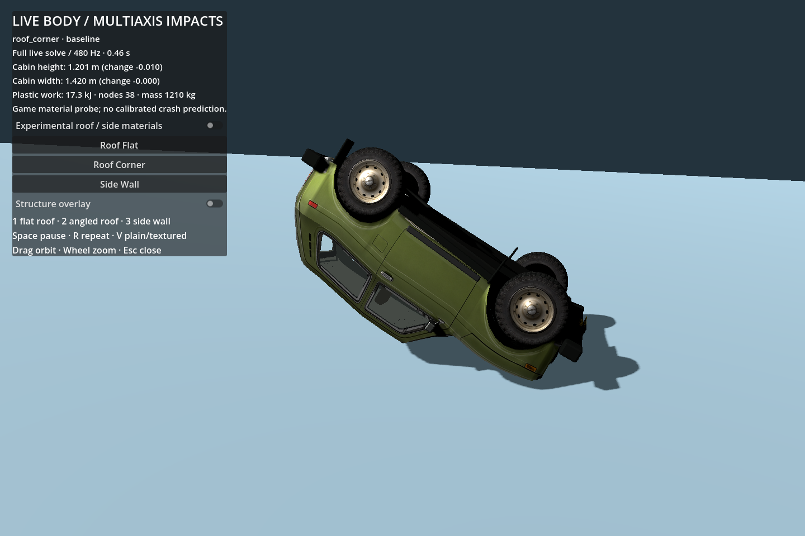
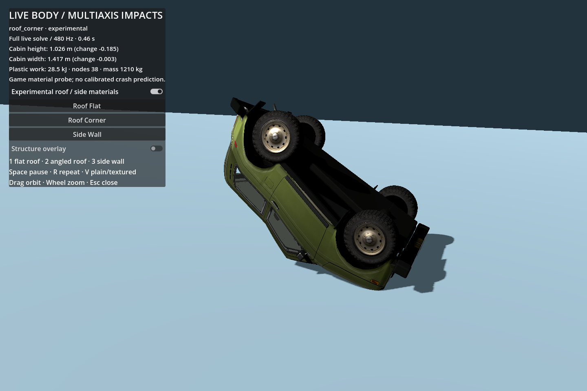
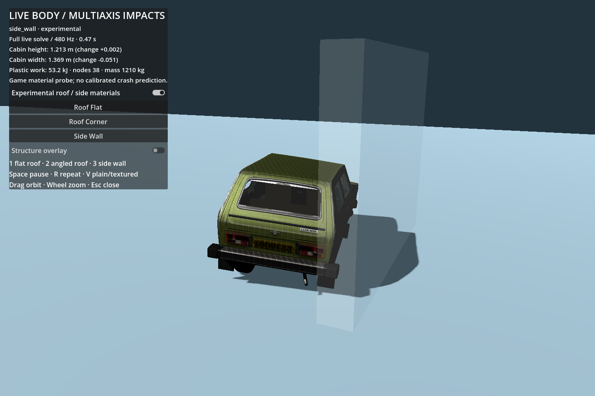

# Live roof, side and angled body deformation probe

The full structural solver already supports three-dimensional motion and plastic distance constraints. It does not disable deformation on a particular axis. Two separate limits explain the reported stiff roof:

1. The sandbox's **baked mode intentionally keeps the body rigid outside playback**. An arbitrary roof landing cannot create a newly solved body collapse there. This probe explicitly switches to full live simulation.
2. In the published live graph, the cabin uses the same stiff `ring` material for lower crossmembers, roof crossmembers, vertical pillars and wall diagonals: 2.4 MN/m stiffness, 110 kN yield and only 12% plastic compression. Roof/body masses can roll or rebound while the closed cage barely changes shape. Mixed-height cabin braces and A-pillar links reinforce that cage.

No factory material data or certified crash validation is claimed. This is a bounded game-material comparison.

## Measured baseline and experimental response

All cases use the same 38 nodes, 187 links, 1,210 kg mass, wheel assemblies, engine/frame definitions and 480 Hz / eight-sweep full solver. Symmetry is disabled. Roof cases start with the closest surface 1 m above the floor and 8 m/s downward velocity; the corner case adds 15° pitch, 20° roll and 3 m/s horizontal travel. The side case launches the rotated car into the static wall at 80 km/h.

Cabin height is an average of six **intrinsic floor-to-roof/pillar lengths**, and width is an average of five intrinsic transverse lengths. A rigid rotation cannot create their reported compression.

| Case | Original peak height loss | Experimental peak height loss | Original peak width loss | Experimental peak width loss |
|---|---:|---:|---:|---:|
| Flat inverted roof | 16.2 mm | 178.9 mm | 0.4 mm | approximately 0 mm |
| Angled roof corner | 15.4 mm | 200.9 mm | 0.6 mm | 6.3 mm |
| Side wall | approximately 0 mm | approximately 0 mm | 30.2 mm | 70.2 mm |

The maximum local upper-ring span loss in the side case grows from 14.0 to 100.6 mm. After removing gravity/contact loads and relaxing the structure for 0.5 seconds, experimental flat/corner cabin height losses remain 166.8 / 195.4 mm; the side case retains 50.8 mm of average width loss. These are permanent material changes, not just whole-car reorientation or elastic sag.

All **42 checks passed** across six baseline/experimental runs: finite positions/velocities, floor clearance, mechanical-energy bound, live solve usage, fixed mass/topology, restored original properties, improved roof/side response and retained deformation after unloading. Maximum sampled mechanical energy stayed within 0.007% of the initial value; the check allows an 8% plus 1 kJ tolerance. Static floor/box collision and the graph remain approximate; panel self-contact and tearing are absent.





## Promoted shared material profile and archived baseline

The verified profile is now promoted to the default `structure.json` with **`material_profile: niva_multiaxis_v1`, `material_profile_version: 1`**, so normal full live simulation and all newly recorded bakes use the same roof/side strengths. The original front-bench material definition remains byte-identical to the pre-promotion graph at `structures/niva_front_bench_baseline.json`.

```sh
python3 scripts/build_structure.py                     # promoted structure.json
python3 scripts/build_structure.py --baseline-materials # archived original comparison
python3 scripts/build_structure.py --multiaxis-live      # promoted compatibility alias
```

The `--multiaxis-live` alias writes `structures/niva_multiaxis_live.json` for existing fixture callers; it is the same promoted definition. The old `experimental` boolean/API name is retained for compatibility: true selects the promoted profile, false explicitly selects the archived original profile.

The promoted profile keeps lower crossmembers, sills, front rails, engine, mounts, wheel properties and topology unchanged. It changes only the following cabin/roof paths:

| Link class | Stiffness N/m | Yield N | Compression / extension cap | Damping Ns/m |
|---|---:|---:|---:|---:|
| Roof ring | 300,000 | 12,000 | .55 / .15 | 450 |
| Cabin pillar | 300,000 | 8,000 | .70 / .12 | 400 |
| Cabin diagonal | 100,000 | 3,500 | .70 / .25 | 200 |
| Roof longitudinal | 1,400,000 | 18,000 | .45 / .14 | 750 |
| Mixed-height cabin roof brace | 120,000 | 3,000 | .75 / .40 | 220 |
| Upper cabin planar brace | 180,000 | 6,000 | .65 / .40 | 250 |
| Auxiliary A-pillar | 350,000 | 8,000 | .65 / .20 | 400 |
| Auxiliary roof crossmember | 500,000 | 18,000 | .50 / .15 | 450 |

These are intentionally visible game parameters, not factory calibration. Promotion changes the structure fingerprint: **previous bakes must be regenerated/revalidated** before they can represent this profile. This patch does not silently rewrite the bank.

Non-timing promotion regressions passed six structural cases, seven wheel cases,18 ordinary-driving checks and the ramp flight/landing checks. Rear retention and all ramp support/alignment checks remained true. One historical retention outcome changed: a120 km/h offset crash now bends the front mounting by about36° and breaks one support without fully detaching that wheel; the compliant cabin absorbs more energy. The old assertion demanding front release at that exact speed needs a material-aware test update, while explicit front-mount overload tests should retain the release-capability requirement. Suspension thresholds were not weakened to force the old outcome.

## Reusable sandbox fixture API

`scripts/body_impact_fixture.gd` operates on the existing vehicle and graph:

```gdscript
const BodyFixture = preload('res://scripts/body_impact_fixture.gd')
BodyFixture.start(vehicle, 'roof_corner', 1.0, true)
# Other cases: 'roof_flat', 'side_wall'; final bool false compares original materials.
```

The fixture disables baked mode and adaptive representation changes, applies the selected link properties in-place, resets/poses the existing nodes and hub orientations, and supplies the declared initial velocity. It does not move render vertices or add another rigid body. Existing tyre/power parameters remain unchanged. The side case uses the current barrier position; roof cases temporarily disable that barrier.

Before an ordinary reset or wall-start fixture, call:

```gdscript
BodyFixture.restore(vehicle)
vehicle.reset(...)
```

`restore` returns cached original link configuration/properties, `adaptive_enabled` and `barrier_enabled`. It does not repair the current shape itself; the following ordinary vehicle reset does that. The main scene should uncheck its baked-mode control when starting the live fixture and keep that UI state in sync. Temporary baseline comparison properties last only until restore/reset; normal restoration returns the promoted/default caller configuration.

Suggested sandbox buttons: **Live flat roof drop**, **Live angled roof drop**, **Live side impact**. The root agent owns that scene wiring; this branch deliberately does not alter its input/UI implementation.


## Bake authoring descriptor

`BodyFixture.descriptor(case_name, impact_speed_mps=-1, clearance=1)` returns a versioned JSON-safe descriptor: full `rotation_xyzw`, `initial_velocity_mps`, `family` (`roof_floor` or `side_wall`), floor/clearance/wall offsets and `material_profile`. `start` accepts the same speed as an optional fifth argument. Negative speed preserves the live fixture defaults of8 m/s downward or80 km/h broadside.

This is an initial-loading descriptor, not an assertion of contact speed: gravity adds speed during a roof drop. The recorder must detect the floor contact event and measure or normalize its normal velocity, as for wall bakes. Roof/corner classification and registration require a full3D car frame; the earlier ground-plane/yaw-only classifier is insufficient. Keep independent roof/side families and normals in the recording metadata rather than disguising a roof drop as another horizontal heading.

## Standalone inspection and reproduction

```sh
godot --path . res://body_impact_probe.tscn
godot --headless --path . --script res://scripts/verify_body_impacts.gd
godot --path . --script res://scripts/capture_body_impacts.gd -- --capture-body
```

On macOS use `/Applications/Godot.app/Contents/MacOS/Godot`. The probe exposes an original/promoted material toggle on identical fixtures. 1/2/3 select flat roof/corner/side, Space pauses, R repeats, V switches plain/textured skin, and drag/wheel orbit and zoom. Playback is slow presentation of the actual full solve, not a baked animation.

For a matched baseline capture:

```sh
godot --path . --script res://scripts/capture_body_impacts.gd -- --capture-body --baseline-materials --capture-case=roof_corner
```

Fresh numerical output goes to `verification/body_impacts_validation.json`; a saved local result is [body_multiaxis_validation.json](body_multiaxis_validation.json). GPU screenshots are generated under `verification/` and retained above for review. Material parameters, impact loading and coarse skin should still be steered visually as the new roof/side bakes are generated.
