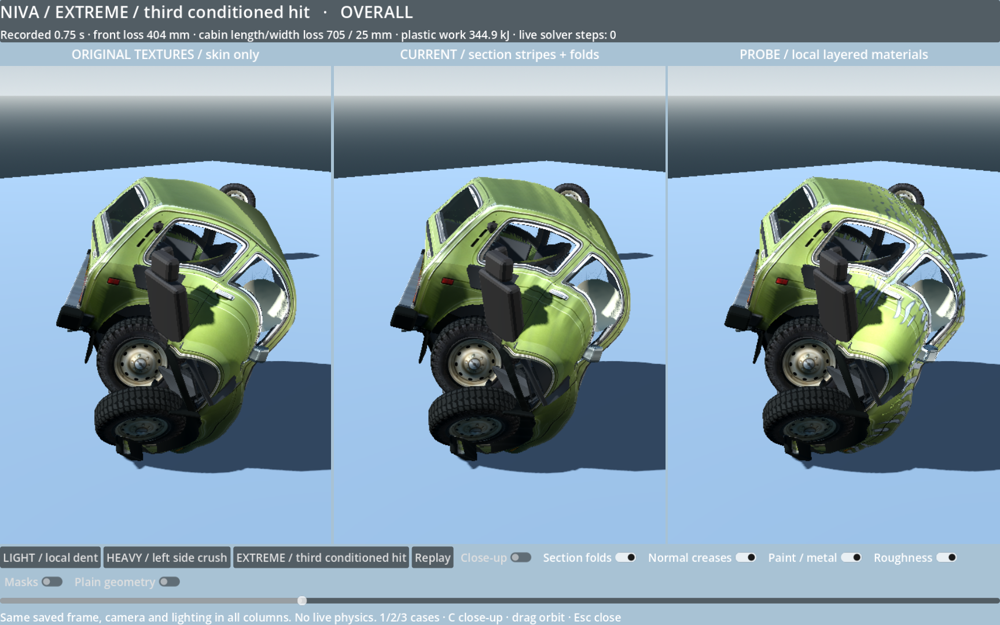

# Collision surface treatment: research and rendered probe

This document records the original research/probe revision. The subsequent shared-runtime candidate integration is documented in [Damage material integration](DAMAGE_MATERIAL_INTEGRATION.md); its cosmetic adapter changes and compatibility receipts supersede the original “shared runtime unmodified” scope below. Artistic texture acceptance remains pending.

This isolated worktree is based on main `90aabde`. It changes no shared solver, mass, model, textures, standard bank or sandbox. The new comparison scene renders the **same actual saved car state** three times: original textures with the native skin only, existing section detail, and section folds combined with local damage layers. The severe treatment deliberately remains strong at an ordinary inspection distance; it is not only a close-up roughness change.



## What established games teach us

The particularly relevant first-party source is Evolution Studios' **DRIVECLUB** description. Its damage pipeline combines exposed-area scratch layers that reveal substrate, dent/parallax detail for smaller damage, and physics-driven vertex deformation for severe damage. Those are complementary scales, not competing choices. [PlayStation / DRIVECLUB, item 28](https://blog.playstation.com/archive/2014/06/05/51-driveclub-details-might-just-blow-mind)

| Regime | Established technique to reuse | Probe implementation / limit |
|---|---|---|
| Light dent or scuff | Fine dent/normal or parallax detail, clearcoat roughness, limited scratches | Restrained normal and roughness treatment; preserve paint identity and the recorded 32 mm frontal dent |
| Heavy impact | Real displaced body plus localized paint → primer → metal material layers | Actual 180 mm cabin-width loss; broad contact-facing abrasion and more pronounced local normal response |
| Severe crush | Large geometric collapse, stronger folds, substrate exposure; detached/ruptured topology where appropriate | Actual 705 mm cabin shortening, useful section folds retained, jagged coating peel and exposed-metal strips; **no claim of physical holes** |

Ironwood's **Pacific Drive** interview describes damage spreading out from an actual corner contact, weakening with distance, and per-part visual responses to damage type and magnitude. This supports spatial and material locality; a single global “car damage” slider is insufficient. [Ironwood / Epic interview](https://www.unrealengine.com/developer-interviews/pacific-drive-is-a-run-based-driving-survival-game-with-an-ever-changing-mysterious-landscape?lang=en)

Volition's **Saints Row: The Third** developer article describes spatial collision-driven morph weights and shader interpolation of artist-built deformation targets. It is a useful precedent for separating the damage state, geometry representation and rendering; it does not establish that a material can create missing geometry. [Victor Cepeda, Game Developer March 2012, p.16 onward](https://media.gdcvault.com/GD_Mag_Archives/GDM_March_2012.pdf)

For implementation, normals must be blended as directions. The probe uses reoriented normal mapping rather than averaging RGB normal maps, and surface-gradient bump evaluation after skinning so procedural detail follows the deformed surface. [Barré-Brisebois / Hill](https://blog.selfshadow.com/publications/blending-in-detail/), [Mikkelsen's paper](https://mmikk.github.io/papers3d/mm_sfgrad_bump.pdf), [later JCGT framework](https://jcgt.org/published/0009/03/04/)

A recent first-party **Project Car Crash** development article also demonstrates a packed persistent damage map, distinct scrape detection, bounded stamp queues, rest-space placement and detail reflected consistently by the paint. This is a useful current engine example, **not evidence of a mature shipped game's performance**. Its separation of impact deformation from sliding paint abrasion is especially relevant: a sideways grind can have very little normal closing speed. [Stellarica implementation and interactive paint lab](https://stellarica.io/blog/car_crash_damage)

Native Godot Decal nodes are not the route used here: the documented Compatibility path lacks those decals, whereas normal/albedo/roughness channels can be composed directly in the car material. A fixed projected card also does not automatically follow a folding skinned panel. [Godot decals](https://docs.godotengine.org/en/4.5/tutorials/3d/using_decals.html), [spatial shader attributes](https://docs.godotengine.org/en/4.5/tutorials/shaders/shader_reference/spatial_shader.html)

## Run, inspect and reproduce

From this worktree:

```sh
/Applications/Godot.app/Contents/MacOS/Godot --path . \
  res://probes/damage_surfaces/probe.tscn

# Focused correctness, lifecycle, locality and CPU budget checks:
/Applications/Godot.app/Contents/MacOS/Godot --headless --path . \
  --script res://probes/damage_surfaces/verify.gd

# Actual native screenshots, including mask and plain-geometry diagnostics:
/Applications/Godot.app/Contents/MacOS/Godot --path . \
  --script res://probes/damage_surfaces/capture.gd -- --capture-surfaces

# Native per-viewport render counters; GPU timing availability is recorded:
/Applications/Godot.app/Contents/MacOS/Godot --path . \
  --script res://probes/damage_surfaces/benchmark.gd
```

1/2/3 select the light, heavy and extreme states. **Replay** runs their saved body/wheel/glass/interior animation at quarter speed; it never invokes structural or cloth simulation. Drag to orbit; C switches close-up. Toggles isolate section folds, fine normals, paint/metal and roughness. **Plain geometry** disables all surface detail and original normal textures; **Masks** displays plastic damage red, external-contact influence green and compressive history blue in the proposed column. The original and current columns remain reference treatments.

All columns use identical lighting and camera within a comparison. A rigid inspection registration removes the saved car's global yaw/roll and places it above the floor, making local deformation easier to inspect. It does not change inter-node distances, plastic rest lengths, failure state or mass. Cameras differ between the side hit and frontal cases to actually show the affected panel; these are not matched-camera cross-severity quantitative images.

| Saved fixture | Source / sample | Measured state |
|---|---|---|
| Light | Probe-local 20 km/h full frontal, 1,920 Hz, t=2.5 s | 31.6 mm front loss; 3.0 mm cabin length loss; 6.5 kJ plastic work |
| Heavy | Existing 120 km/h left-side slam, t=1.0 s | 179.6 mm cabin width loss; 152.1 kJ plastic work |
| Extreme | Third transition of the existing 60→60→120 family, t=0.75 s | 404 mm front loss, 705 mm cabin length loss; 344.9 kJ cumulative plastic work |

These categories identify the **observed deformation**, not universal speed-to-damage or real-car fracture thresholds. The light case is included under `probes/damage_surfaces/data/`; regenerate it with `make_light_case.gd`. The other two are read from the existing main bank without rewriting it.

Evidence: [light close-up](../probes/damage_surfaces/evidence/light_close.png), [heavy contact-facing abrasion](../probes/damage_surfaces/evidence/heavy_close.png), [extreme close-up](../probes/damage_surfaces/evidence/extreme_close.png), [mask diagnostic](../probes/damage_surfaces/evidence/heavy_mask.png), [extreme plain geometry](../probes/damage_surfaces/evidence/extreme_plain.png). The PNGs are actual Godot output, not generated illustrations or edited mockups.

## What the probe does

`surface_skin.gd` subclasses the existing skin and adds two read-only custom vertex attributes at construction: full 3D rest position and rest normal. Original UV0, weights, indices, materials and native bones remain intact. The damage shader runs only on outer body/panel surfaces. The inner panel skins, glass, tyres, lights and seats keep their own materials.

The field uses the existing 38 saved node-damage/contact values and 187 saved link rest lengths. Eight neighboring body-node samples are interpolated using the same body sections as native skinning, preserving left/right and vertical locality. A tiny derived peak-compression history is built once from each clip, so unloading a link does not erase its earlier fold treatment. This requires no new physical nodes, solver steps or per-frame mesh reconstruction.

The proposed material is intentionally layered:

- Section-driven folds keep the existing compression envelope and rest-space phase. Their capped 22 mm cosmetic displacement follows the **post-skin surface normal**, avoiding the original shader's world/model-Y offset when the car rolls. This is render detail, not new collision geometry.
- Smaller millimetre normal creases modify highlights and reflections. A neutral detail normal preserves the source normal; degenerate triangles have a derivative guard.
- Contact-facing scuff increases roughness. Higher contact/plastic exposure reveals primer and then brighter metal. Severe fold regions additionally receive broken, jagged coating-peel strips, with interruption and phase variation rather than continuous identical rings.
- The strongest layer is **paint/coating removal on folded sheet**, not a black painted opening. There is no automatic scorch, fire damage or rust. Untouched paint is retained.

The procedural patterns are deliberately inspectable placeholders. They demonstrate placement, layering, persistence and severity, not finished vehicle texture art. A production pass should replace repeated procedural motifs with a small authored family of dent/crease and gouge normal/mask tiles. Keep variation seeded and attached to the surface. The main silhouette still comes from the existing mesh/graph, and extreme self-intersections remain visible in the plain diagnostic.

## Limits that matter before main integration

**The source colour atlas shares UVs between sides.** In `model/source/build_niva.py`, `sideuv(p)` ignores the cross-car coordinate. Writing a unique scratch into that UV0 would mark both sides. Current UV2 is only rest X/Z, losing height and overlapping more surfaces. Use a unique dedicated damage UV channel, per-panel map, or part-indexed storage; preserve UV0 for the reference colours. This is an asset/storage decision, not a reason to rerun expensive car physics.

The atlas also contains paint and trim in one material. This probe reconstructs an olive-paint eligibility mask from colour to protect black/chrome trim. **That is Niva-specific and temporary.** Production needs an explicit paint/substrate ID mask, vertex attribute or split material; otherwise changing paint colour would change eligibility.

Saved `node_contact` is only a peak scalar. It does not retain each contact's direction, sliding distance, slip direction or per-pixel exposure. The probe uses the clip's dominant local impact normal for external abrasion; that is adequate to demonstrate these three cases but does not reconstruct arbitrary subsequent scrapes or exact coating failure. A compressed fold can crack coating without touching a wall, so strain-driven peel and contact-driven abrasion remain distinct.

Neither normal nor parallax mapping creates a silhouette cut, depth-bearing torn edge, hidden underside or a new disconnected component. For actual panel rupture, coordinate this work with the separation probe: real cut geometry, inner liner/substrate, jagged thickness/ribbons and attachment ownership belong to the fracture representation. Materials colour and shade those exposed surfaces. Do not conceal stretched triangles or missing inner surfaces with black albedo.

## Performance and bake path

`evidence/validation.json` records 26 passing checks: unchanged graph/mass, original source fingerprints, left/right/height locality, peak history after unloading, exact rest attributes, UV/binding preservation, plain-mode isolation and zero structural/membrane/airbag solves. The shared runtime is unmodified; this probe's focused checks supplement main's already-passed baseline.

The final headless Apple M3 measurement was approximately **57 µs** to assemble the field and **97 µs** for native pose plus field upload, compared with **32 µs** for the unmodified skin pose call. These are CPU call timings, not GPU cost. The shader adds **zero draw calls**, keeps 39 bones / 39,673 triangles, and adds **391,616 bytes** of rest attributes per displayed car. Derived compression history is **45,752 bytes per 301-frame clip**, built in roughly 20 ms at load, not on collision.

Native Godot per-viewport CPU submission measurements and actual viewport sizes are saved in `native_budget.json`. The M3 Compatibility driver returned **0 for GPU timestamps**, which means unavailable. The similar CPU submission numbers do **not** show equal shader cost. This prototype uses several procedural-noise evaluations per pixel and is not a measured whole-game FPS optimization. For production, sample a small prefiltered detail atlas and packed damage map, keep the clean material cheap, allocate per-car damage state on first damage, and restrict expensive relief/parallax work to nearby hero detail if it is still useful.

For main integration, keep the existing section structure and introduce a cosmetic surface-state owner under the shared effects lifecycle. Read graph damage/contact, add true scrape events before collision-severity filtering, and record sparse rest-space mark events with part/UV identity, surface normal, slip direction, extent, strength, deterministic seed, timestamp and stable event ID. Preserve an initial cumulative surface state for conditioned transitions. Replay those marks or their prebaked masks **without waking physics**. Keep paint loss/scuff monotonic, deduplicate release/stamp IDs, repair explicitly, and checkpoint only as needed for reverse seeking. Do not save a full 4 MB texture in every 120 Hz frame.

Conditioned matching must include permanent surface state/schema so a later clip cannot heal old paint. Current coarse fields can be derived from old clips, but exact directional scrapes need new recorded events. Actual tear seams also need the correct component/part identity when surface ownership splits.
