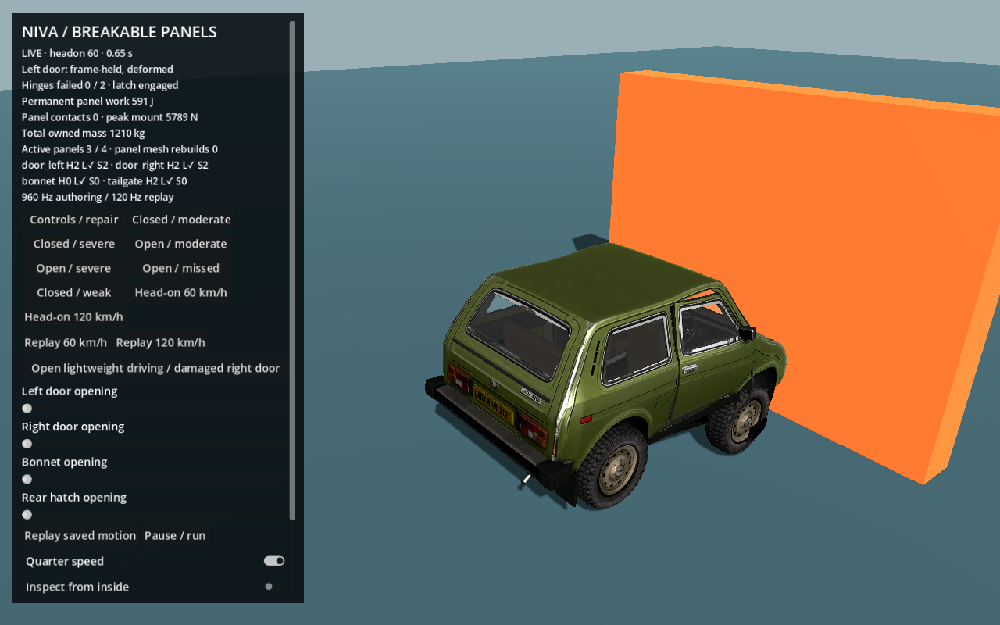
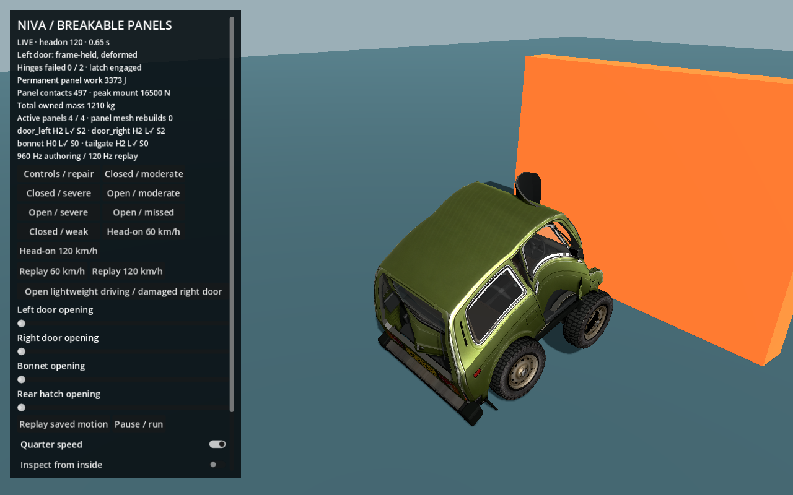
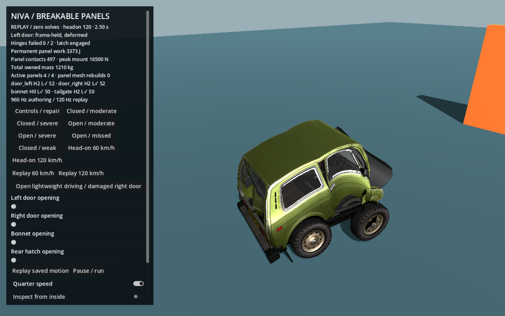
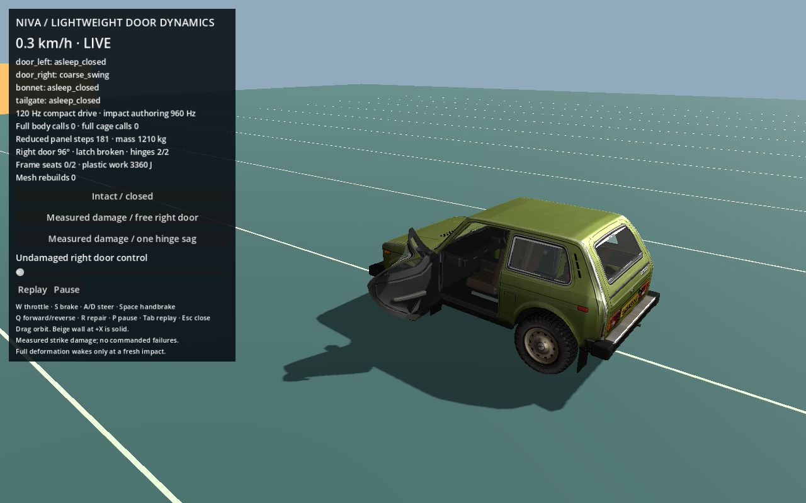
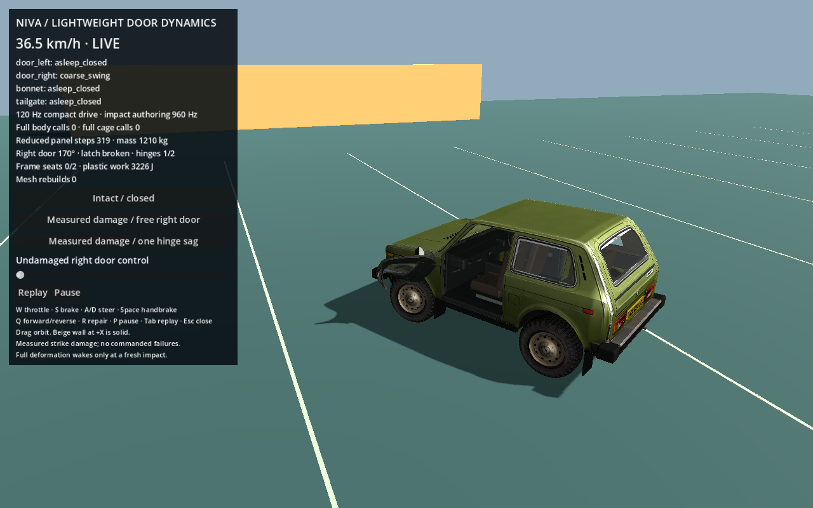

# Head-on crashes and lightweight damaged-panel driving

This extends the isolated [operable-panel probe](ARTICULATED_PANEL_PROBE.md). It changes only `probes/panels/`; the production driving sandbox, GLB, shared solvers and main crash bank remain unchanged.

The current conservative road-profile and stiff-hinge correction supersedes the early outcomes/one-hinge approximation below. See [driving fix and current evidence](PANEL_DRIVING_FIX.md).

## Run and steer the probe

```sh
cd /Users/roni-saroniemi/Downloads/car-sim-lowpoly-panel-damage-probe

# Start normally closed, lightweight driving; choose a measured damaged-door case:
/Applications/Godot.app/Contents/MacOS/Godot --path . res://probes/panels/drive_probe.tscn

# Immediate replay of an actual recorded 60 km/h car-to-static-wall crash:
/Applications/Godot.app/Contents/MacOS/Godot --path . res://probes/panels/probe.tscn -- --play-headon-60

# Preserve original tests, then author and verify the new head-on/reduced cases:
/Applications/Godot.app/Contents/MacOS/Godot --headless --path . --script res://probes/panels/verify.gd
/Applications/Godot.app/Contents/MacOS/Godot --headless --path . --script res://probes/panels/verify_extended.gd

# Reproduce the measured right-door damage starting states:
/Applications/Godot.app/Contents/MacOS/Godot --headless --path . --script res://probes/panels/prepare_drive.gd

# Actual native screenshots:
/Applications/Godot.app/Contents/MacOS/Godot --path . res://probes/panels/probe.tscn -- --capture-headon
/Applications/Godot.app/Contents/MacOS/Godot --path . res://probes/panels/drive_probe.tscn -- --capture-drive-panels
```

Driving controls match the main sandbox: W throttle, S brake, A/D steering, Space handbrake, Q forward/reverse. R repairs, P pauses, Tab replays the recent recorded motion. Drag to orbit. The flat 120 m test floor has a full-width solid barrier at X=45 m. This is a bounded probe area, not the production ramp sandbox. Opening the healthy right door with its slider uses reduced dynamics; returning the slider to zero seats and relatches it when aligned and quiet.

The first scene has separate **author head-on 60/120** and **replay 60/120** buttons. Authoring really evaluates the deformable car; replay restores the saved graph/panel states without running body, cage or hinge physics. Authoring is deliberately slow on a CPU. The normal driving scene runs compact body/wheel dynamics at 120 Hz, and only wakes 960 Hz detailed deformation for a new local impact.

## Closed means frame connections are engaged

The car starts with all panels latched and their masses condensed into the existing body. There is no free-door simulation during normal closed driving.

During a detailed impact, the door has its two hinges, its primary latch and two finite compliant seats on the rear rim. The seats constrain the panel-normal direction, leaving tangential frame shortening free; the deforming frame supplies their targets and receives reciprocal corrections. They are small game-model seating supports, not a claim that real doors are welded or key-locked at their corners. Plastic cage bending between connections remains possible. A closed crumpled cage is not treated as a rigid door opening angle: the normal closed profile applies no angle servo/stop torque. Frame constraints hold it.

Opening explicitly disengages the latch and healthy closing seats **before** actuator motion. Hinges remain connected. Closing does not immediately reattach anything: the panel must return close to alignment with low angular speed for a quiet interval. Only healthy connections reengage. Broken seats, latch and hinges keep their failure state; damaged controls cannot heal or snap a door closed. Threshold exposure and stable event IDs record why a connection failed.

The original 3.8 kN hinge profile remains in the earlier illustrative striker fixtures. Both new whole-car frontal speeds use the **same** stronger road-car game profile: 16 kN upper hinge, 9.6 kN lower hinge, 8 kN primary latch, and two 25 kN/m normal seats that fail after 3.5 kN for 12 ms. These are explicit chosen game values, not measured factory strength or a validated vehicle safety model. No failure is commanded from a speed label.

## Actual 60 and 120 km/h head-on results

The car is launched from X=-5 m toward a stationary full-width wall. Initial panels are closed and condensed. The solver runs at 960 Hz with damping/failure windows expressed in seconds. Measured mount-pair distortion above 8 mm or local bonnet contact wakes panel cages; direct finite/swept panel contacts also work. This avoids a magically rigid closed door when its surrounding cabin deforms.

| Actual contact speed | Front shortening | Cabin shortening | Left/right maximum permanent cage-edge change | Door closing/mount outcome |
|---|---:|---:|---:|---|
| 60.003 km/h | 0.422 m | 0.031 m | 0.099 / 0.104 m | Both latches, four hinges and all four frame seats retain |
| 119.984 km/h | 0.707 m | 0.189 m | 0.294 / 0.309 m | Both latches, four hinges and all four frame seats retain |

The bonnet loses both hinges but its latch retains in both fixtures, leaving it attached by that remaining connection. Broken hinges do not silently delete a healthy latch or frame seats. Complete release requires every remaining attachment to have failed or been explicitly disengaged. The rear hatch retains its latch/hinges; it develops measurable plastic deformation in the 120 km/h case. These outcomes come from this rig's measured loads and exposure, not a promise that a particular real car would behave this way. A frontal crash does not need to eject doors to demonstrate deformation. Full per-panel loads, failure event histories, energies, timings and contact speeds are in [headon_results.json](../probes/panels/evidence/headon_results.json).





## Cheap modes preserve damage

`drive_runtime.gd` uses the production `CompactChassis` and `VehicleDynamics`; it does not copy a second chassis or add a full-mass rigid car. `reduced_panels.gd` adds these panel modes:

| Mode | Work | Owned mass |
|---|---|---|
| `asleep_closed` | Body mapping/render pose only; no cage, hinge or fragment solve | Condensed in body |
| `frozen_plastic` | Current deformed shape follows its mounting frame; no plastic solve | Condensed in body |
| `coarse_swing` | Frozen shape on one rigid pose with two hinge points, or one surviving point for sag; three small joint sweeps | Extracted once from body |
| `full_impact` | Original ten-node elastoplastic cage and reciprocal mounting constraints | Extracted once from body |
| `detached` / `detached_sleep` | One rigid pose, five finite contact proxies; sleep after quiet ground contact | Remains independent, never duplicated |

A two-hinge door has five constrained rigid degrees of freedom and one free hinge angle. The second hinge allows axial sliding in the coarse approximation, avoiding an impossible rigid constraint if the damaged hinge spacing has changed. A one-hinge state is a coarse ball-joint-like damaged mount and can sag/tumble; it is not a complete bearing simulation.

Gravity, actual body acceleration/braking/cornering and contact impulses drive the free door. Joint/stop impulses react into the same compact aggregate. Angular stops and bearing damping bound intact two-hinge opening. A damaged door has no angle servo. Retained frame seats still hold a door closed even if its primary latch has failed; that is a frozen held panel, not a free hinge. The one-hinge approximation has no pristine-door angular stop and can rotate farther.

Freezing saves the current cage shape and plastic lengths. Rigid linear/angular motion comes from the cage's mass-weighted momentum and inertia. The transfer boundary changes neither render points nor velocities. Non-rigid velocity components are projected out on the next reduced step; their removed energy is explicitly reported. Quiet closure saves the exact current local shape, condenses the mass and corrects body linear/angular momentum rather than teleporting to pristine geometry. Broken flags and existing plasticity persist.

The car still owns **1,210 kg exactly once**: 25 kg per door, 18 kg bonnet and 22 kg hatch are extracted from lower body donors only while independently active. Compact aggregate mass is refreshed after transfers. Wheels retain their original independent ownership. A released panel changes constraints, not mesh resources or mass. Its source glass, mirror, trim and inner/back faces follow the same frozen shape and pose.

A cheap local barrier/velocity gate wakes new deformation. The probe uses a bounded 0.65 s detailed impact window, then freezes the current body/panel state and returns to compact/reduced motion. This is an authoring prototype, not a finished general settling policy. Residual body/panel projection energy is reported rather than hidden.

## Measured damaged-right-door driving cases

`prepare_drive.gd` records a real 9 m/s side-striker experiment, stopping after measured closing failures. It does not set broken flags from a case label. In the free-door variant, the latch and both closing seats fail while both hinges retain. The sag variant uses the same upper-hinge strength with a deliberately weaker lower-hinge fraction, and the measured load breaks that lower hinge too. This is a labeled weakened-mount experiment, not a random damage toggle. Source states, plastic cage, velocities, chassis distortion and failure histories are saved in `right_free.panelstate` and `right_sag.panelstate`.





The normal closed, free-door and one-hinge driving tests each advance 1,200 updates at 120 Hz with **zero full structural steps and zero cage plastic steps**. Only the free/sag variants advance reduced panel dynamics. Matched coast/brake and straight/turn trajectories verify that controls change the door's physical response. Detached panels retain their frozen shape, contact the floor and sleep when quiet. New wall contacts demonstrably wake detailed deformation and subsequently return to reduced mode.

## Verification, timing and replay

The original 78 checks remain, plus 84 checks in the extended suite in [extended_validation.json](../probes/panels/evidence/extended_validation.json). It verifies actual wall speed, common material settings, positive single-count mass, finite/bounded energy, closed-panel deformation while connections retain, explicit opening/closing topology, resleep for all four panels, low-load retention, irreversible damage, inertial response, hinge stops, new-impact wake/return, detached contact/sleep and exact disk replay with zero live solves. Both forward and backward inspection seek through reduced recordings is checked.

Simulation CPU mean/p95/p99 values are reported per **120 Hz update** in the extended report. These cover shared compact wheel/body dynamics plus panel dynamics, excluding native rendering, UI and the probe's snapshot recorder. Head-on authoring timings are per **960 Hz full solve**; they are not directly comparable to a single 120 Hz update without multiplying by substep count. First-release costs and the original native render budget remain in the first probe's evidence.

On this M3 run, the simulation CPU measurements were:

| Case | Mean | p95 | p99 | Detailed body / cage calls |
|---|---:|---:|---:|---:|
| Closed driving, per 120 Hz update | 1,153 µs | 1,205 µs | 1,380 µs | 0 / 0 |
| Measured free right door, per 120 Hz update | 1,343 µs | 1,794 µs | 2,526 µs | 0 / 0 |
| One-hinge sag, per 120 Hz update | 1,410 µs | 1,887 µs | 3,101 µs | 0 / 0 |
| 60 km/h authoring fixture, per 960 Hz step | 5,747 µs | 6,652 µs | 8,706 µs | 2,400 / 6,645 |
| 120 km/h authoring fixture, per 960 Hz step | 6,629 µs | 7,368 µs | 8,319 µs | 2,400 / 9,191 |

The authoring rows include probe sampling/energy bookkeeping; cage counts sum independently active panel integrations, each with eight constraint sweeps. Fresh-impact driving authoring has eight detailed substeps per update: its mixed approach/impact/aftermath test measured 22.4 ms mean / 52.0 ms p95 / 59.4 ms p99 per 120 Hz update. That expensive path is bounded to the impact window; it is not used merely because a door is open or damaged. Timings vary with machine/load. These are CPU measurements, not a fixed frame-rate guarantee.

The car renderer still has 25 draws and 39,673 triangles; there are 40 panel bones in addition to the 39-bone body skeleton. Correct native panel pose upload is retained, approximately 255 µs versus 32 µs baseline in the final native M3 comparison (the earlier capture measured 247/33 µs). Sleeping physics does not remove that rendering cost. GPU timestamps are unavailable here; these numbers are not a whole-game FPS claim.

Head-on files contain 301 graph/panel samples at 120 Hz. Driving recordings retain at most 481 samples at 60 Hz. Zstd-compressed disk checkpoints include body/wheel states, panel frozen shape/pose/velocity, mass ownership, closing/latch/hinge damage, modes and event IDs. This verbose probe format repeats immutable bindings; it is not a proposed final bank format. Replay only restores data and render poses. The production selector does not yet know these panel states.

## Remaining limits before main integration

- The test adapter covers the flat floor and one bounded static barrier. General Godot-world contact adaptation, panel/body self-contact and arbitrary geometry are not implemented.
- Frame seats and failure strengths are chosen game constraints. More geometry/material calibration and longer damaged-driving endurance are needed.
- The frozen shape remains fixed until a fresh detailed impact. The 0.65 s detailed window and projection are explicit probe approximations.
- One-hinge sag is a coarse point-joint model. The door may turn through the body because general self-contact is absent.
- Glass/trim follows panels correctly, but shared glass membrane fracture/debris is not coupled into this isolated probe. Existing interior/airbags are not given duplicate simulation ownership.
- Bonnet/hatch controls, closure/sleep and frontal bonnet failure are covered. Dedicated open-bonnet/open-hatch obstacle strikes remain untested.
- Main crash-bank integration needs component-frame/ownership metadata and conditioned rebakes. Existing full-mass production clips cannot receive another independent 25 kg door without removing that mass from the aggregate.
