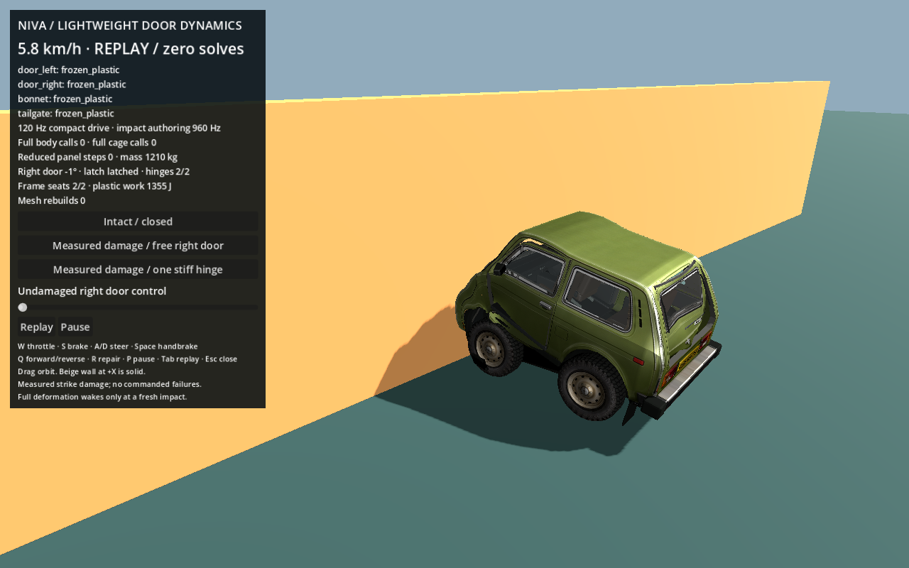
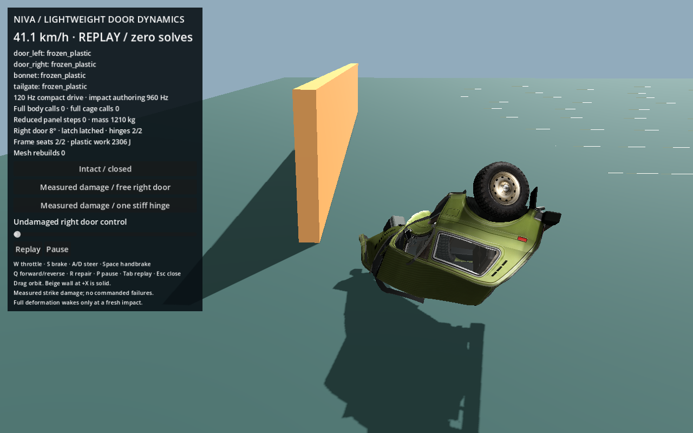
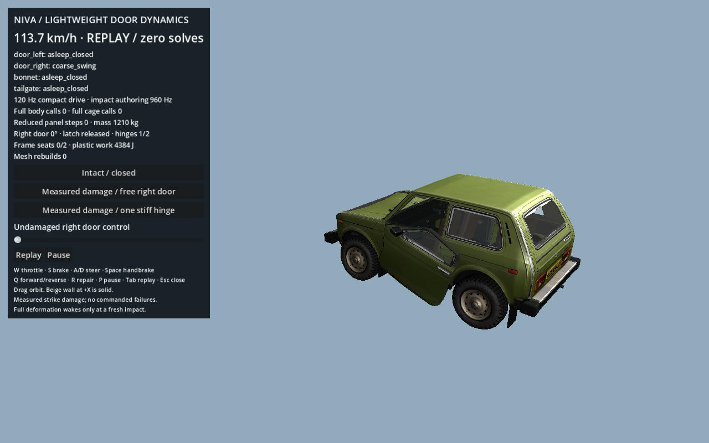
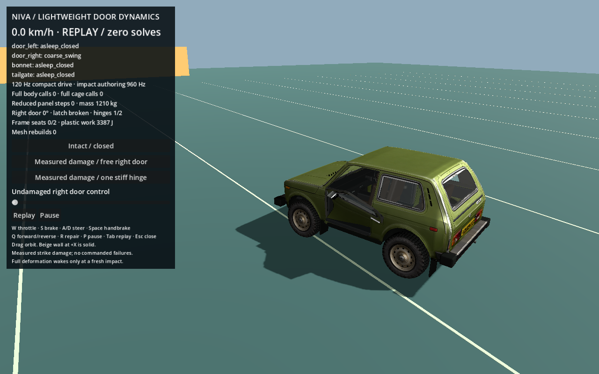
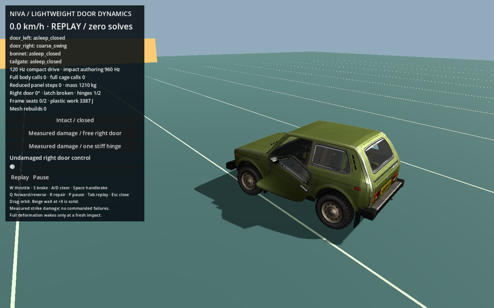
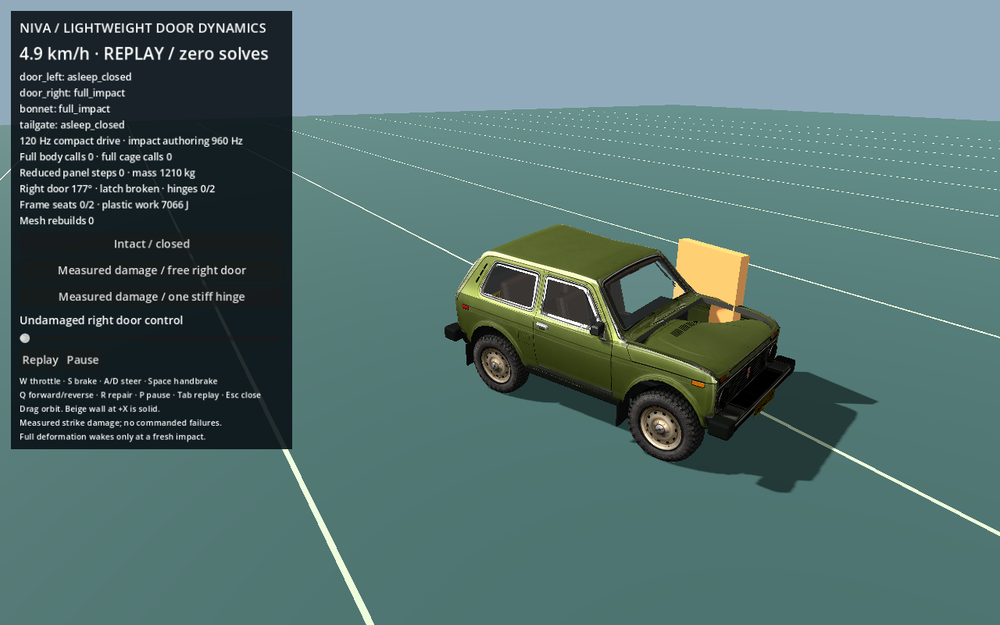

# Conservative road panels and stiff surviving hinges

This is the current mechanical correction to the earlier panel probe. The user approved this panel setup for main integration. It remains isolated until that integration is reviewed. The old striker demonstrations are explicitly named `illustrative_weak_striker`; actual driving, head-on authoring and measured side fixtures now all use `RoadPanelProfile.ID == road_panels_v2`.

## Reproduced driving bug and fixes

The actual `drive_probe.tscn` path inherited 3,800 N / 1,300 N demonstration hinges/latches while head-on fixtures explicitly assigned 16,000 N / 8,000 N. Holding W from rest hit the actual driving barrier at 83.02 km/h and broke both doors' hinges plus bonnet/hatch mounts. Door frame seats could remain connected, but the coarse approximation still looked like everything fell loose. The original event/load trace is [driving_failure_before_fix.json](../probes/panels/evidence/driving_failure_before_fix.json), based on commit `990cf0d`.

`road_panel_profile.gd` now supplies one explicit profile at driving setup, restore and head-on authoring. Broken state is preserved when applying it. The measured free and one-hinge driving starting states are produced by 6 and 12 m/s local side pulses using this same profile; no weak reference or manually assigned failure is used in ordinary driving.

High force alone no longer breaks every panel during global deceleration. Closed connections require recent actual local contact, inward contact alignment above 0.70, measured intrusion and plastic strain. Latch/seat failure and hinge failure remain separate. Severe local mount-metal tearing can accumulate from an already measured overload plus substantial nearby plastic strain, even after the instantaneous force falls; each event records the criterion, local strain and episode peak. This is a conservative game behavior model, not a calibrated real vehicle.

| Property | Road profile |
|---|---:|
| Upper/lower hinge force | 16,000 / 9,600 N |
| Latch force | 8,000 N |
| Closing seat force | 3,500 N |
| Closed hinge/latch exposure | 45 ms |
| Closing-seat exposure | 35 ms |
| Exposed/open mount exposure | 24 ms |
| Closed hinge / closing connection intrusion gate | 0.160 / 0.065 m |
| Severe mount-tear path | >0.45 m inward intrusion, >0.16 m local hinge-edge plastic change, measured episode force >1.25× strength, sustained exposure |

An open panel instead requires actual local lever contact and plastic deformation. Complete release still requires all remaining engaged hinges/latch/seats to have failed or been explicitly disengaged, plus substantial local damage. There is no vehicle-speed label or global frontal immunity rule. A sufficiently local inward strike can tear a mount even if the car approached forward.

Two numerical correctness issues were also fixed:

- Detailed-impact wake and reduced contact now cover the same five finite proxies, including depth point 9. The omitted point previously hit a post before full wake and displaced the whole reduced door.
- The compact chassis advances before reduced panels. Joint stabilization now compares the pre-integration panel against a velocity-rewound body target. The old future-target comparison introduced a full-step lead: approximately 0.139 m at 60 km/h. The corrected measured hinge residual is about 0.9–1.2 mm before full handoff, with unchanged cage edge lengths. The open-post tests assert under 12 mm.

Actual panel-only contact now marks the vehicle impact time, so a door striking an obstacle while the chassis misses is observable rather than reported as “no collision.”

## A surviving hinge is stiff and yielding

`panel_angular_mount.gd` adds a reciprocal angular mount about the surviving hinge. It resists tilt while retaining the primary opening degree of freedom. Cage authoring and reduced rigid motion use the same rest-axis/plastic state; outside new impacts it needs no full-body or cage solve.

- Stiffness: 4,500 Nm/rad; damping: 140 Nms/rad.
- Yield: 900 Nm; plastic rest-axis change persists, capped at 30° in this probe.
- Extreme tear: 6,500 Nm sustained for 60 ms with substantial permanent and elastic angular strain.
- Gravity and ordinary driving keep the remaining attachment stiff; this is no longer a free ball joint.
- A bounded 1,800 Nm external-moment fixture bends it permanently without release; a 20,000 Nm sustained fixture tears it. These are explicit applied-load experiments, not claimed collision-speed calibration.

The damaged free-door fixture can arrive with an inward pose from its recorded side strike. Its pose and momentum are preserved. The stop regression checks the settled interval after one second rather than demanding an immediate snap to an undamaged opening limit. Healthy open/close tests retain their ordinary limits and quiet reclosure checks.

## Verification and native evidence

**109 actual-driving checks pass**, alongside the original **78** and updated **84** checks. `road_driving_validation.json` includes all four panels' profiles, contact directions, plastic strain, loads, connection states, timestamps and mode handoffs.

- Actual W-from-rest driving collision: 83.02 km/h; all four panels remain attached and deform.
- Actual DriveRuntime approaches: 60/120 km/h at 0°, ±20°, ±30°; closed doors remain hinged, latched and seated. Reported travel and wall-normal contact speeds are distinct.
- Open-door forward/oblique strikes against a side post: actual local contact and damage, with unrelated panels retained.
- Side crusher at 12 m/s: one surviving hinge; at 24 m/s: complete local release with all closing connections failed. The external kinematic fixture supplies work.
- Braking/turning and a benign ramp retain normal closed mounts; ordinary driving and stiff hinge motion use zero full-body/cage steps.
- Mass remains 1,210 kg once. Release and mode handoffs preserve pose/momentum; irreversible shape and damage survive recording/replay.

The screenshots below are actual native Godot captures of recorded simulation states, reviewed visually:








The reduced driving CPU measurements per 120 Hz update in this run were:

| Case | Mean | p95 | p99 | Full body / cage calls |
|---|---:|---:|---:|---:|
| Closed | 1,150 µs | 1,228 µs | 1,237 µs | 0 / 0 |
| Free right door | 1,247 µs | 1,313 µs | 1,321 µs | 0 / 0 |
| Stiff surviving hinge | 1,336 µs | 1,448 µs | 1,521 µs | 0 / 0 |

These CPU timers exclude rendering and snapshot recording. Existing panel skin upload remains an additional cost, approximately 255 µs versus 32 µs baseline. No GPU-time or whole-game FPS claim is made.

## Reproduce

```sh
/Applications/Godot.app/Contents/MacOS/Godot --path . res://probes/panels/drive_probe.tscn
/Applications/Godot.app/Contents/MacOS/Godot --headless --path . --script res://probes/panels/prepare_drive.gd
/Applications/Godot.app/Contents/MacOS/Godot --headless --path . --script res://probes/panels/verify_road_driving.gd
/Applications/Godot.app/Contents/MacOS/Godot --headless --path . --script res://probes/panels/verify.gd
/Applications/Godot.app/Contents/MacOS/Godot --headless --path . --script res://probes/panels/verify_extended.gd
/Applications/Godot.app/Contents/MacOS/Godot --path . --script res://probes/panels/capture_road_evidence.gd
```

The isolated probe still lacks general panel/body self-contact and main glass-membrane ownership. A detached side-hit panel can pass through the body; this is visible in the native severe-side aftermath and is not claimed solved here. Main integration must adapt mechanics under the graph/runtime, preserve the merged damage material, map door glass to its panel once, and extend physical bake snapshots/compatibility rather than overlay independent panel mass on historical full-mass clips.
