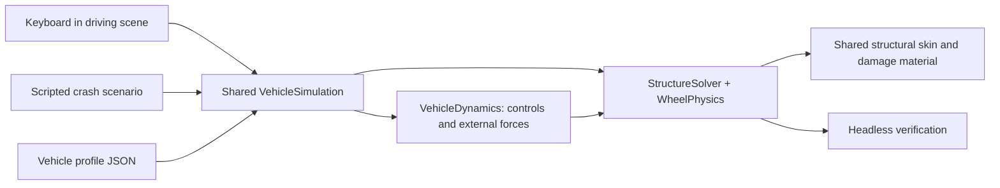
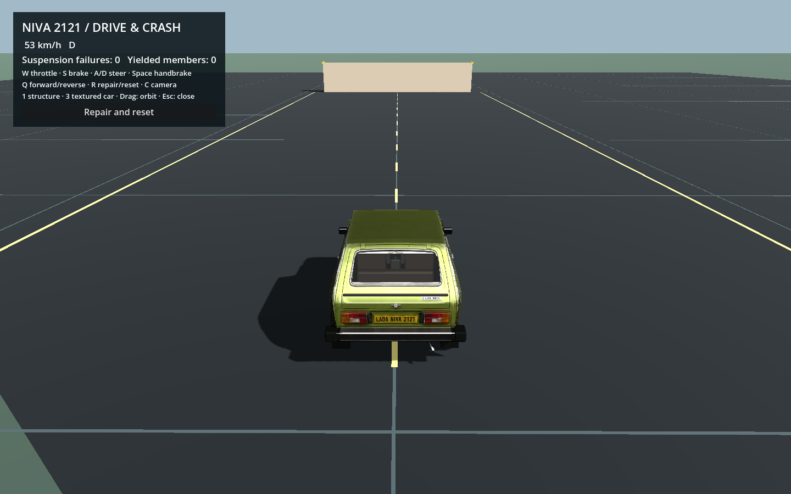
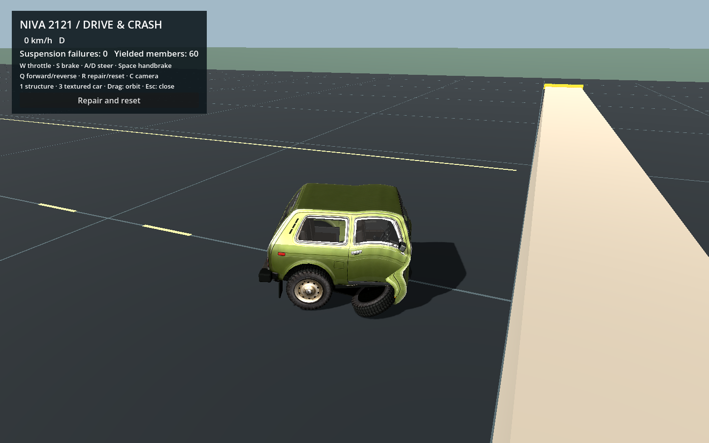

# One vehicle simulation, two test scenes

The driving sandbox and crash bench instantiate the same `vehicle_simulation.gd`.
Neither scene implements its own suspension, tire contact, damage or drivetrain.
Changes to the physical vehicle are therefore tested without copying them into
another project.



## Run it

```sh
python3 tools/demo.py drive
python3 tools/demo.py run
python3 tools/demo.py verify
```

`drive` opens a practice area with two smooth ramps with the same finite-box crash barrier that
the custom solver supports. W accelerates, S brakes, A/D steer left/right,
Space applies the rear handbrake, Q selects forward/reverse, R repairs/resets,
C changes camera, H stages a head-on approach, J/K stage the two jumps, T runs the aligned/bent/detached wheel-mount test, and 1/3 switches structure/textured views. You can drive into
the barrier, inspect the wreck, and continue applying controls without resetting
its damage. Opening a new scene or pressing R creates a pristine state.

This is the first driving scene for the deformable vehicle. It is separate from
the earlier VehicleBody3D/Jolt demo: no older project folder is needed. The course
has a shared analytic floor/ramp heightfield and one static box. Halfpipes and
arbitrary Jolt-world contact remain future work. The [adaptive runtime](ADAPTIVE_SIMULATION.md)
uses a rigid body aggregate during ordinary driving and wakes the deformable
solver before forecast impacts; cleared forecasts and low residual energy can
return it to the lighter state.

Actual driving and post-impact frames from the shared runtime:




## Boundaries that keep updates small

| File | Owns | Does not own |
|---|---|---|
| `vehicles/niva.json` | Model/structure paths and car-specific dynamics values | Input keys, cameras or track geometry |
| `vehicle_simulation.gd` | Profile loading, the solver instance, reset, controls, fixed-step entry points | UI or a second chassis body |
| `vehicle_dynamics.gd` | Steering command, motor/brake torque, speed taper, aerodynamic drag | Another set of wheel positions or damage state |
| `wheel_physics.gd` | Hub/spin state, tire contact/friction, knuckles, suspension failure | Keyboard handling or scene cameras |
| `structure_solver.gd` | All translational masses, structural constraints, persistent damage, analytic contact | Rendered body triangles |
| `structural_skin.gd` | Model loading, skeleton binding, structural/body views | Physical load transfer |
| `driving_sandbox.gd` | Keyboard, HUD, camera and visible practice area | Duplicated vehicle dynamics |
| `structural_probe.gd` | Controlled impact settings, recording, inspection and crash verification | A separate crash-only vehicle implementation |

The runtime API is deliberately small:

```gdscript
var vehicle = preload('res://scripts/vehicle_simulation.gd').new()
vehicle.setup('res://vehicles/niva.json', true) # enable driving forces
vehicle.reset(0, Vector3(-25, 0, 0))
vehicle.set_controls(throttle, brake, steering, handbrake)
vehicle.advance(frame_delta) # adaptive fixed substeps
```

The crash scene calls `step(fixed_delta)` so it can record every substep and hold
at three seconds. The driving scene calls `advance(elapsed)` for continuous
operation. The runtime selects 120 Hz aggregate driving or 480 Hz structural
substeps; a passive bench remains on the full structural baseline. The tests compare 30 Hz and 120 Hz frame chunking.

`setup(..., false)` is the controlled passive crash baseline: initial velocity,
gravity, contacts and material deformation, with motor/brake/aero controls
inactive. That keeps historical impact comparisons meaningful. Set driving true
for a powered/braking crash scenario; it still uses the same graph and wheels.
Do not hide suspension or tire changes inside the driving-only input layer.

## Adding dynamics later

For a tire improvement, edit the shared wheel module and add tire/drive checks;
both scenes use that wheel module immediately. For a drivetrain improvement,
replace or extend the torque calculation in `vehicle_dynamics.gd`. For suspension
or material changes, update the graph generator or wheel constraints. Add a new
module only when the implementation becomes substantial enough to justify one;
there is no plugin registry or generic feature bus to maintain.

The present drivetrain is intentionally small: total wheel torque, a power cap,
a speed taper, braking torque, rear handbrake and speed-sensitive steering.
Torque changes wheel spin; tire contact transfers forces to the structural car.
Braking reduces spin without reversing it. There is no independent rigid body
moving the car while the damage graph merely follows it. Broken/detached wheels
are excluded from power delivery; fully detached wheels also stop receiving
brake/steering commands. External drag is distributed across attached masses.

The 160 km/h profile value is a nominal power taper, not a measured speed
certification or a hard velocity clamp. The wheel friction model is still a
simple game approximation, without a full slip curve, tire-pressure model,
engine map, transmission, differential or traction control. Such changes belong
in shared dynamics/wheel code and should have observable behaviour checks.

## Adding another car

Copy the profile, change its `structure` and `model` paths, then set
`vehicle_profile` on either scene in the Godot inspector. Tune wheel indices,
torque, brakes, steering, grip and drag in the profile. Restart the scene to read
edited values; there is no live-reload service.

A profile does not automatically fit a new mesh or suspension. The current
structural generator and skin still assume the documented seven-section layout,
body-node groups and wheel naming. Follow [Adapting a car](ADAPTING_A_CAR.md) to
supply a compatible graph and skin first. This change makes physics reuse easy;
it does not claim arbitrary topology support.

## Verification

`python3 tools/demo.py verify` runs the six structural cases, seven wheel cases
and the driving checks. `verify-driving` runs just the latter. They cover:

- Acceleration from wheel torque and reduced speed under braking.
- Left and right steering directions, reverse and profile-sensitive acceleration.
- Ordinary driving/turning without suspension breakage.
- Crash damage retained while driving controls continue on the same graph.
- Reset clearing controls/damage, finite motion, and frame-chunk independence.

Fresh driving results are in `verification/driving_validation.json`. GPU preview
capture is `python3 tools/demo.py capture-driving`; it writes a driving frame
and a post-impact frame. These render the real scene with scripted controls;
headless reports alone do not establish visual quality. The existing Linux CI
command runs the new checks too. Rendering and actual multi-car performance
remain separate checks. Aggregate/full handoff, forecast recovery and energy
cutoff have their own adaptive checks; the same wheel module and state are used
in both modes. Baked playback is a [separate controlled probe](BAKED_CRASH_PROBE.md).

Wheel mounts now restrain sideways drift and unwanted tilt until yield. Strong
loads create permanent alignment/offset; the configured damage/load limits
release every support through one shared method. See [Wheel physics](WHEEL_PHYSICS.md).
