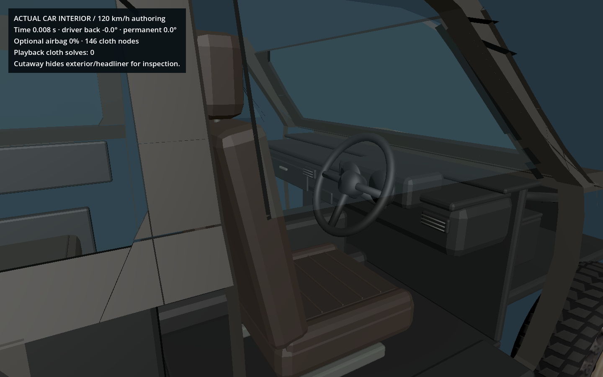
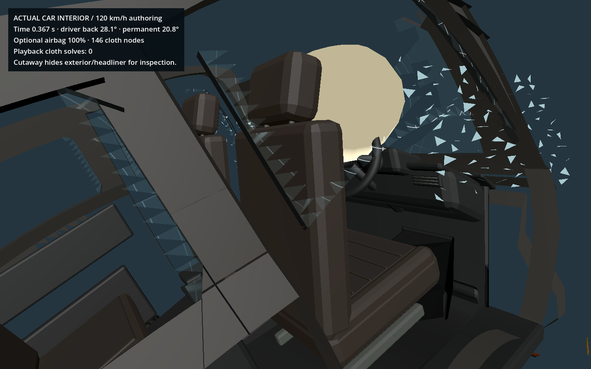

# Live and baked interior effects on the actual car

`vehicle_interior.gd` implements the shared effects-controller contract. It drives the existing car's two front backrest/headrest groups and an optional steering-mounted cloth airbag. The structural graph remains the sole owner of the vehicle's **1,210 kg / 38 mass nodes**; interior response is cosmetic and one-way.

## What changed

The GLB is unchanged. On first skin binding, `interior_geometry.gd` finds the original disconnected front-seat components in canonical rest space, preserving vertex attributes, indices and materials. The 12,498 interior triangles are partitioned into:

| Group | Triangles |
|---|---:|
| Remaining original interior | 9,146 |
| Driver / passenger cushion, base and rails | 1,296 each |
| Driver / passenger backrest, insert, headrest and posts | 380 each |

All 12,498 triangles remain. The renderer retains the original source mesh for restoration if the adapter is removed. Seat bases use lower-floor chassis nodes, so roof motion does not drag a seat mount upward. A separate hinge rotation acts on each actual backrest group. Exterior panels, windows, wheel geometry and the source Blender/GLB files are untouched.

The seat hinge uses a damped spring with an elastic/plastic rest angle. Its input is mounting acceleration relative to gravity, projected onto that seat's current forward axis. Inertia/load terms are equivalent response parameters, not extra chassis or occupant bodies. Both front seats have configurable profiles; equivalent occupant loading defaults to zero.

The optional airbag has 146 nodes and 288 triangles, with structural and bending/tether distances, a closed-volume inflation constraint, neck anchors and local dashboard/torso proxy collisions. Its attachment frame matches the existing steering mesh's structural mapping. It solves at 240 Hz only after deployment in live mode. A frontal wall-contact gate, deceleration threshold, short-window delta-v exposure and minimum prior speed suppress deployment under ordinary braking, low-speed bumps and non-frontal impacts. These thresholds are game parameters, not a production restraint-controller design.

The sample profile enables the airbag as an **optional demonstration retrofit**; it makes no original-equipment claim for the historical vehicle. Configure `vehicles/niva_interior.json` or pass `{"airbag":{"enabled":false}}` to controller setup. Profile identity includes the full merged configuration hash.

## Live recording and baked playback

The shared vehicle runtime calls the existing controller once after live physics. Each snapshot contains profile/version identity, seat hinge angles/angular velocities/plastic rest and work, deployment event ID/time, and attachment-local cloth poses/velocities. `begin_playback` and `restore_interpolated` apply that state directly. They do not run seat or cloth constraints. Recorded node poses and hinge angles interpolate; deployment state advances at its authored sample. A backwards seek or legacy empty state can restore the intact initial state; repair clears plastic bend and deployment.

`step_debris` is a no-op for this module. Strict baked driving therefore incurs no seat or cloth solve after playback either: the last interior pose follows its moving car mounts. Resuming live mode synchronizes acceleration caches without clearing irreversible state. `irreversible_state()` exposes only profile, seat plastic angle/work, deployed flag and event ID for conditioned impact selection; transient cloth poses and clocks should not be used as a condition key.

## Actual-car evidence

These are real Godot cutaway renders of full-graph 120 km/h authoring frames, using the normal shared skin/effects post-bind hook. The camera hides exterior panels and bright headliner faces for inspection; it does not replace the interior with probe primitives. The merged glass controller is present in the same car. Playback reports zero cloth solves.

| Before impact | Peak backrest deflection and deployed cloth |
|---|---|
|  |  |

[Deployment frame](images/actual_interior_deployment.png) · [Retained bend after the crash](images/actual_interior_after.png)

On the promoted main graph, the actual 60 km/h run produced **13.30° peak additional hinge deflection / 5.93° permanent set**. The 120 km/h run produced **28.13° / 20.75°**. The 20 km/h case stayed elastic and did not deploy the bag. Disabling the optional bag also produced zero cloth steps. These are additional rotations relative to the model's existing reclined seat geometry.

## Reproduce and verify

```sh
# Uses graph.effects.interior when the shared runtime provides it; no double stepping.
python3 tools/demo.py import
/Applications/Godot.app/Contents/MacOS/Godot --headless --path . --script res://scripts/verify_vehicle_interior.gd
/Applications/Godot.app/Contents/MacOS/Godot --path . --script res://scripts/capture_vehicle_interior.gd
```

The verifier can also run against an isolated pre-effects base for module testing. On the integrated shared base, **29 checks passed**: four actual crash cases, ordinary braking suppression, finite/anchored cloth, unchanged vehicle mass/nodes and chassis motion, exact disk replay of local seat/cloth poses, no live/cloth solve during playback, conditioned-state retention through synchronization, repair/legacy defaults, and actual-mesh extraction without triangle loss. Fresh reports go to `verification/vehicle_interior_validation.json`; the checked local evidence is [vehicle_interior_validation.json](vehicle_interior_validation.json).

The earlier [standalone probe](INTERIOR_DYNAMICS_PROBE.md) remains useful for isolated parameter experiments. Its timing numbers describe that separate solve, not the full car. The production module supplies `input_fingerprints()` for recorder provenance, covering its profile, controller, hinge/cloth solver, geometry/visual adapters and attachment helper.

## Limits

This is a small elastoplastic hinge plus constrained cloth approximation. It does not simulate seat-rail tearing, a human body, belts, seat-back contact with a collapsing roof, complete fabric packaging, gas flow, vents or cloth self-collision. Unfolding is approximated by ramping rest distances and target volume; pressure is held after inflation in this version. The retained sheet can intersect itself under extreme loading. Ordinary gameplay should use the baked poses rather than requiring all authoring constraints every frame. More realistic restraint or occupant interaction requires new validation and explicit mass/momentum ownership.
