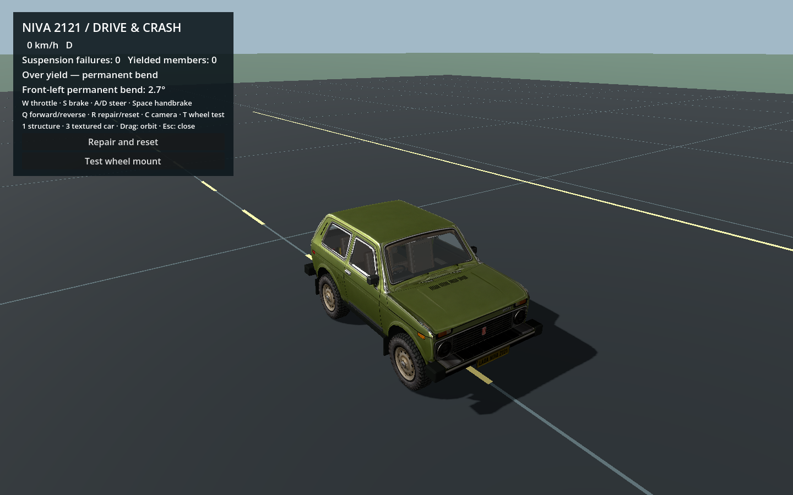
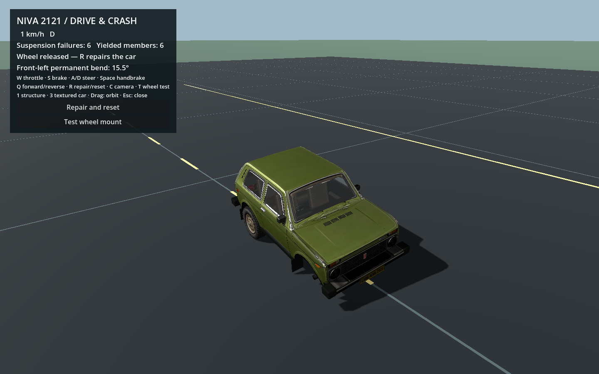

# Wheel physics and crash interaction

The current example includes orientation-aware wheel contact, independent hub tilt and rim spin, yielding/breakable suspension, limited tire compression and selective wheel-to-body contact. The graph still has **38 mass nodes, 187 links and 1,210 kg total mass**. Rotational degrees of freedom do not add a second copy of wheel/chassis mass.

## Try it

Run `python3 tools/demo.py run`. The default is **Offset / left front wheel**, 120 km/h, slow motion. Switch between bare structure, plain and textured views; the wheel meshes follow the simulated hub and spin. The telemetry shows suspension failures, detached wheels, hub tilt relative to the adjacent body section, and whether wheel/body contact occurred. Scrub the held replay to inspect when those changes happened.

Use Full-width frontal for a symmetric comparison. Changing setup and starting a new impact resets the simulation. The offset setup releases the symmetry boundary. A severe impact may bend/break some supports without ejecting a wheel; detachment is not an automatic speed-triggered effect.

## Representation and solver ownership

`structure_solver.gd` owns each wheel centre's position, velocity and 20 kg mass. `wheel_physics.gd` adds:

- Hub orientation quaternion and transverse angular velocity.
- Rim spin angle and angular speed about the hub's axle.
- Approximate rotational inertia from mass, outer radius, rim radius and width.
- Tire-contact compliance and a maximum compression allowance.
- A yielding angular knuckle relationship to the adjacent deforming body section.
- Six individually yielding/breakable suspension connections and three local body-contact capsules.

Hub orientation and rim spin are separate. Suspension anchors follow the hub, so turning the rim through a bearing does not twist the suspension hardpoints around the axle. Rendering composes hub orientation with spin. Contact friction can change spin through torque about the axle; suspension-anchor impulses act on the hub's non-spin rotation.

Wheel kinetic energy includes translation and rotation. Initial spin is set from speed/radius for rolling motion. Angular velocity reconstruction uses a quaternion-vector/atan2 form to retain signed small rotations; an axis/angle extraction near identity can lose precision in single precision.

All wheel motion stays in this solver, including after detachment. No Jolt RigidBody3D is silently spawned and no mass is counted twice. This keeps the controlled crash example self-contained. A future Jolt handoff must remove the old solver's ownership and transfer centre velocity, hub angular velocity, spin and inertia explicitly.

## Suspension and knuckle response

Every wheel connects to body nodes through six local hub hardpoints: three suspension members, a steering link and two upper-arm support links. For a hardpoint offset `r` rotated by the hub, the distance constraint uses the world anchor `wheel_centre + r`. Its effective inverse mass includes a rotational term:

```text
rotational_weight = (r × normal) · inverse_inertia(r × normal)
```

That makes an off-centre load tilt the wheel as well as move it. The body endpoint receives the opposite linear reaction. Axial damping includes the anchor velocity from hub rotation.

The default mount has no intentional lateral or angular elastic flex below
yield. Its lateral coordinate follows the adjacent chassis side rail and local
cross-car axis; vertical suspension travel and bearing spin remain free. The
constraint reacts against the deforming body nodes. It is not a lock to the
world or to the velocity vector, so reversing, standing still and whole-car
sliding remain possible. Commanded steering is included in the neutral target
and is not counted as permanent damage.

Lateral force above 18,000 N can move the permanent mount offset; torque above
6,500 N·m can permanently change alignment. Angular correction stores a vector
impulse, so reversing correction axes does not lose the signed load history.
Both constraints cap the transmitted impulse at yield and record the unresolved
motion as plastic deformation. Below yield the lateral constraint has zero
compliance; `rigid_mount_until_yield` also gives the angular constraint zero
compliance. Setting that flag false restores the configured angular stiffness.

Each suspension link still has its own force/damage overload timer. In addition,
a sustained mount force above 90,000 N or torque above 18,000 N·m, a permanent
alignment of 65 degrees, or a permanent lateral offset of 0.20 m releases the
whole wheel. Force overload must persist for 0.035 s; geometric damage limits
are checked at the end of the substep. Complete mount release removes all six
links and the lateral/angular restraints together. It retains position,
velocity, orientation and spin. Failure no longer leaves a broken angular
knuckle hanging from the remaining supports. Loss of all six individual links
also uses this same release path.

The angular yield now sits above ordinary practice-ramp landing loads. The
previous 2,500 N·m threshold let normal landing corrections accumulate permanent
rear camber; on the high 60 km/h ramp this reached 17–21 degrees. With the current
mount, both ramps complete takeoff and landing without broken supports or
measurable permanent alignment. The longer overload interval rejects short
inertial correction spikes; force alone must persist to count as mount rupture.
Geometric release still catches a severely pulled-apart or twisted mount. These
are local constraint demands and irreversible mount displacement, with no
vehicle-speed or front/rear-specific immunity.

Replay records permanent lateral offsets and release reasons along with wheel
orientation/spin, alignment and broken links. Reset restores every mount.

This is an approximate generalized suspension/knuckle model, not a dimensionally exact reconstruction of the Niva's real suspension. The driving layer supplies basic steering/drive/brake commands, rather than a complete powertrain model.

## Finite-width tire contact

A sphere is cheap but cannot represent the width of a tilted wheel. The new contact shape uses a convex radial disk plus an elliptical shoulder. Its support point depends on the wheel's orientation and the requested contact normal; the shape remains continuous around small tilt angles.

World contact is against the analytic floor and finite static barrier box. Soft contact permits up to **45 mm** of tire compression; after that allowance is exhausted a harder constraint carries the load. This is a contact-envelope approximation: the rendered tire is not a physically pressurised, visibly flattening sidewall/rim simulation.

Contact friction applies an impulse at the wheel support point, affecting translation, hub tilt and rim spin. The coefficient is currently a single fixed game value, 0.65, with small rolling/bearing loss. There is no slip curve, separate longitudinal/lateral tire model, gyroscopic treatment, puncture or pressure model. The static bench remains a passive controlled test. The shared driving layer now supplies wheel torque, braking and steering; see [Shared runtime](SHARED_VEHICLE_RUNTIME.md).

## Wheel-to-body load transfer

Each wheel has three configured capsule segments tied to nearby structural node pairs. The front wheel's candidates represent a sill segment behind the opening, a firewall-side vertical member and upper engine-bay structure. They are intentionally sparse; connecting collision along every frame bar would incorrectly fill the wheel opening.

Broad-phase distance rejection skips distant candidates. Narrow contact uses the wheel's oriented support point and closest point on the deforming capsule. The positional response moves both the wheel and the capsule's two structural endpoints, weighted by their mass and contact location. It therefore changes the graph's load distribution and can change permanent link lengths, rather than merely offsetting a visual wheel.

These are selected local contacts, not general self-collision or a triangle-perfect wheel housing. Crumpled panels, the engine and other wheels do not automatically become additional collision partners. Candidate pairs must be fitted to a new car's geometry and neutral wheel clearance.

`wheel_body_constraint_impulse_ns` sums positive solver correction estimates over the run. It is a diagnostic, not a calibrated measurement of the physical contact-force history. `body_contact_events` counts correction events across substeps/iterations, not distinct crash events.

## Configuration

Edit `scripts/build_structure.py` for persistent changes, then regenerate `structure.json`. Wheel definitions are under `wheel_assemblies`; suspension records remain in `links`.

| Property | Current value / meaning |
|---|---|
| Wheel node mass | 20 kg each, already included in the 1,210 kg total |
| `radius_m` | 0.390 m |
| `rim_radius_m` | 0.255 m; used in shape/inertia approximation |
| `half_width_m` | 0.105 m |
| `max_tire_compression_m` | 0.045 m contact-envelope allowance |
| `contact_stiffness_n_per_m` | 320,000 N/m |
| `axle_body_nodes` | Four adjacent section nodes defining the moving body frame |
| `knuckle_stiffness_nm_per_rad` | 24,000 N·m/rad when rigid angular mode is disabled |
| `rigid_mount_until_yield` | true: zero angular compliance before yielding |
| `lateral_yield_n` / `lateral_break_n` | 18,000 / 90,000 N |
| `mount_break_delay_s` | 0.035 s sustained overload |
| `detach_alignment_deg` / `detach_lateral_offset_m` | 65 degrees / 0.20 m permanent damage |
| `knuckle_yield_nm` / `knuckle_break_nm` | 6,500 / 18,000 N·m |
| `body_capsules` | Three local node-pair segments, radius 0.045 m |
| Link `wheel_anchor` | Hub-local hardpoint offset, metres |
| Link `break_force_n` | 48,000 steering / 90,000 suspension / 110,000 upper arm |
| Link `break_delay_s` | 0.035 s accumulated overload |
| Link `break_plastic` | 0.90 of the configured plastic deformation allowance |

Fit radii, width, axle/body frame, anchor offsets and capsule candidates first. Run the standing-support check before tuning yield/break strength. Keep a neutral clearance around the wheel opening, then inspect low-speed and severe offset impacts. Do not lower every break threshold simply to force a spectacular ejection.

## Verification

`python3 tools/demo.py verify` runs the structural, wheel and driving suites. For only the latter:

```sh
python3 tools/demo.py verify-wheels
```

The wheel suite contains seven three-second cases: 20/50/80/120 km/h full-width; 80/120 km/h offset; and an otherwise identical 120 km/h offset run with wheel/body contact disabled. It compares permanent link rest lengths as well as final positions, so a changed global car pose alone is insufficient to claim changed crumpling.

Focused checks also cover:

- Standing hubs remain upright and suspension remains supported/unbroken.
- Direct internal contact produces equal/opposite mass-weighted translation.
- Force/time thresholds release supports without a position/velocity kick.
- A deliberately detached wheel continues colliding with the bench.
- Replay restores wheel orientation and detachment/link states; reset clears damage.
- Low-speed impact does not eject wheels; the severe offset case loads the body and fails some supports.

The detached-wheel test deliberately overloads supports to exercise that branch. It does not claim that all supports detach in the default crash. Tire/body motion is checked for finite state, contact clearance and excessive energy growth. The structural scene suite additionally verifies that rendered wheel bone bases match the simulated hub/spin transforms.

Replay is for inspection, not a complete checkpoint from which arbitrary solver continuation is guaranteed. Passing these checks supports reproducibility of this game approximation; it does not calibrate a real vehicle crash or prove general-world collision robustness.

## Visible mount test

In the driving scene press **T** or click **Test wheel mount**. The same fixed-step
external-load fixture used by verification applies a modest side load, a brief
bend load, and then a larger failure load to the front-left wheel. It displays
aligned, permanently bent, and released stages at half speed. Press **R** to
repair/reset and resume driving. These are deliberately applied test loads,
not a calibrated curb-strike reconstruction.

`verification/wheel_mount_validation.json` records the isolated load checks and
checks that the visible fixture actually passes through all three states on
the floor with gravity. `verify` and `verify-wheels` include these checks.





A focused retention regression is available separately:

```sh
godot --headless --path . --script scripts/verify_wheel_retention.gd
```

It checks 80/120 km/h full-width impacts in both the structural bench and live
adaptive driving runtime, 80/120 km/h offset impacts, and both practice ramps
at an initial 60 km/h. Rear mounts must remain attached in every impact case;
the severe offset case must still release a front wheel. Ramp checks require
actual flight and landing, all supports retained, finite wheel/body states,
and less than 0.1 degree permanent alignment. The report is written to
`verification/wheel_retention_validation.json`. Optional `-- crash`,
`-- driving`, `-- offset`, or `-- ramp` arguments limit the scenarios.

The direct load fixture still distinguishes alignment, permanent bending and
complete release: its bend pulse is 10,000 N·m for 0.0125 s, and its extreme
angular test applies 30,000 N·m for 0.10 s. Instantaneous release itself preserves
position, velocity, orientation and spin.
