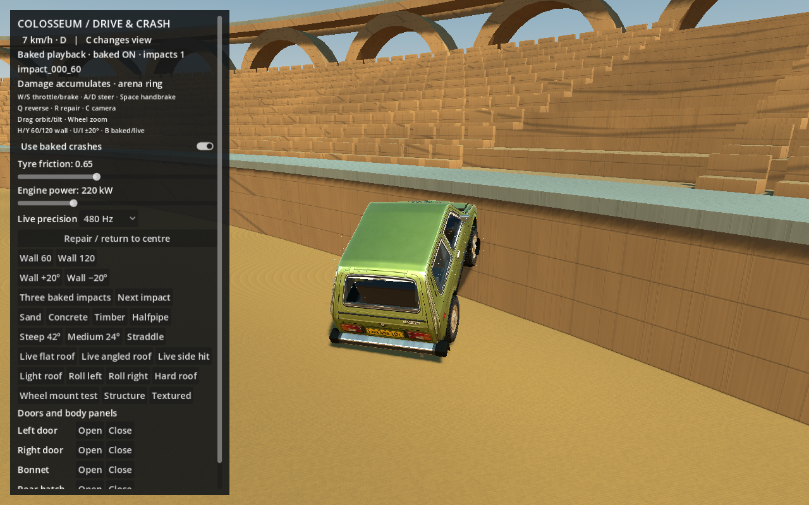
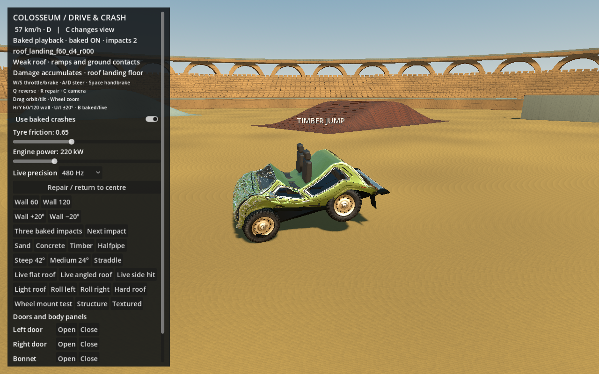

# World contacts and cumulative baked damage

The driving sandbox now has two playback paths. Compatible authored test-wall
and conditioned-sequence recordings retain their existing exact path. Arena-wall,
terrain and later roof contacts can use **incremental local deformation** on the
same damaged car. Absolute snapshots are not added or replayed over each other.

## What previously prevented a rollover from deforming

The roof selector had an unconditional `baked_count > 0` exit and a pristine-state
requirement. A previous crash, wheel damage or panel damage could therefore
prevent roof playback. The retaining wall also had only rigid world contact;
it was intentionally excluded from the planar-wall selector. Earlier roof
selection required a flat floor and narrow pose/speed ranges.

The earliest-contact query could also let a tire touch hide a roof contact later
in the same step. Roof detection now queries non-wheel proxies independently;
a tire-only touch still cannot trigger roof crushing.

There was no per-voxel veto, but these global eligibility conditions had a similar
visible result. They are removed from the incremental path. A rejected attempt
does not latch a voxel or consume a crash. The original car-local grid contributes
to similarity scoring; it does not require impact along a world axis.

## Targets and contact lifecycle

`world_impact_sensor.gd` uses the existing shared terrain and `static_contact`
interfaces. Sand, concrete, timber, halfpipe and paired ramps all use the same
height/normal functions as the rendered arena. The circular retaining wall uses
its actual finite signed-distance shape. Contacts are swept with the existing
body spheres and panel proxies, including angular point velocity.

Roof support can initiate the deliberately weak roof response at nearly zero
speed. Generic body impacts require at least 1.5 m/s normal closing speed.
Wheel-only suspension landings do not use a body-crush recording. Pristine
finite test-wall hits still require the established footprint match; the world
fallback can handle an already damaged car when no conditioned recording fits.

Only a successful contact sets a contact latch. Leaving the target releases it;
the roof requires 0.1 seconds of physical separation. Changing orientation alone
does not reset a roof latch while the car is still resting on it. This prevents
one sustained contact from replaying endlessly and permits a subsequent hit.
External motion also exits lightweight sleep rather than leaving a moved car
frozen above the ground.

## How damage stacks

`incremental_crash_player.gd` removes recorded rigid motion and caches each
clip's local shape changes during setup. At a hit it adds successive changes
to the car's current shape. The existing compact body and wheels continue to
own motion, gravity, suspension and world collision. Source recordings remain
immutable and no full structural, panel-cage, membrane or airbag-cloth solve is
called during this playback.

Previously crushed members receive bounded shape envelopes so another clip
cannot lengthen them back to their pre-crash shape. Damage, broken links,
released wheels, glass stages and surface wear are retained. New recorded glass
and interior states are adopted only when they increase damage/deployment;
earlier failures are not reset. Closed panels follow the deformed body and
independent panels keep their reduced runtime ownership.

A roof hit can also add a second local deformation layer while an incremental
wall crash is still playing. The layers extend the playback duration as needed.
`DrivingVehicle.impact_history` records each accepted hit and roof overlay;
the HUD displays accumulated impact count and the current target family.

This is an approximate game response. Arbitrary histories and curved/partial
targets do not become calibrated simulations merely because their local shape
increments accumulate. Source severities are discrete; the world fallback uses
a bounded severity scale. There is no new general self-collision or whole-body
tearing implementation. Severe roof flattening can expose cabin props; general
seat-to-crushed-roof contact is not implemented by these shape layers. The authored conditioned sequence remains the more
specific option for its exact recorded history.

## Reproduce

```sh
Godot --headless --path . --script tests/world_damage/verify.gd
Godot --path . --script tests/world_damage/capture.gd
```

The suite checks eight arena-wall headings, all five ramp surfaces, wall → roof
→ separated roof contact, a roof overlay during wall playback, retained crush
geometry, mass, irreversible damage, zero full solves and rejection recovery.
`verification/world_damage/validation.json` contains the individual results.
`tests/roof_landing/drive_rollover.gd` additionally exercises driven approaches
to the actual paired ramps. A path that does not touch the body/roof is not
required to deform.

Verification receipt: [current check summary](evidence/world_damage/summary.json).
The 66 dedicated checks passed, including the earlier-tire masking regression.
The driven paired-ramp runs record actual roof support independently of roll
angle, so rotating in midair alone is not counted as a roof contact.




