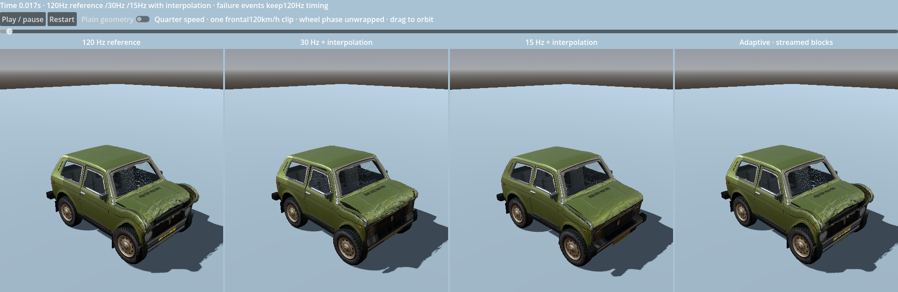

# Adaptive crash-animation sampling experiment

One existing 120 km/h frontal recording was used. **Physics was authored at
1,920 Hz and already saved at 120 Hz.** The experiment changes saved key density
and encoding; it never simulates a crash at 30 or 15 Hz. Rendering interpolates
between keys at the display's cadence.

**Result:** adaptive sampling retained 112 of 301 poses. Snapshot decimation alone
reduced compressed size by about 63%; compact tracks plus exact sparse state
changes reduced it by about 80%, from 5.22 MB to 1.07 MB. This is one clip, not a
validated percentage saving for all 132 main recordings. The normal sandbox
still uses its existing format and 120 Hz recordings.

## Reproduce

From the repository root:

```sh
python 3 tools/demo.py verify-sampling --no-import
python 3 tools/demo.py sampling --no-import
python 3 probes/bake_sampling/bench.py
```

Omit `--no-import` on the first run. The launcher generates experiment files if
missing or their source/codec hashes differ. Generated tracks live under ignored
`verification/bake_sampling/`; the reviewed evidence below stays in this folder.
`GODOT_BIN` can select the binary for the Python load benchmark.

The interactive viewer shows 120 Hz,30 Hz,15 Hz and adaptive side by side. It runs
at quarter speed, has play/pause, restart, timeline scrubbing and a plain-geometry
switch. All views interpolate; failure events keep the reference 120 Hz timing.
The adaptive column loads only its current half-second packet. This is a local
disk-stream example, not an HTTP or multiplayer transport implementation.

## Measured size, loading and fidelity

Apple M 3, macOS, standard Godot 4.7.2 Compatibility. Load/decode is the median of
three fresh Godot processes per variant, excluding process startup, graphics,
model/textures and frame reconstruction. OS filesystem caches were not evicted.
Other development work was concurrent. Heap is the Godot static-allocation delta
for the held decoded data, **not OS RSS, total game RAM or a true allocation peak**.

| Variant | Keys | Compressed MB | Data heap MiB | Load/decode ms | Max metal-node error cm |
| --- | ---: | ---: | ---: | ---: | ---: |
| Original 120 Hz | 301 | 5.217 | 56.56 | 40.71 | 0.00 |
| Packed 120 Hz | 301 | 2.742 | 4.32 | 6.27 | 0.00 |
| Packed 30 Hz | 76 | 0.744 | 1.85 | 2.16 | 27.51 |
| Packed 15 Hz | 39 | 0.416 | 1.44 | 1.57 | 43.60 |
| Packedadaptive | 112 | 1.066 | 2.24 | 2.72 | 0.91 |

The snapshot-only adaptive file was 1.93 MB. It isolates density savings, but does
not provide the packed candidate's separate exact discrete-event timeline.

Uniform 30 Hz had a 1.29 cm RMS error across all 38 body/wheel control points,
with a 27.5 cm worst node error during the first 17 ms. Uniform 15 Hz reached
43.6 cm worst error. Their panel-proxy errors reached 16.4 cm and 34.3 cm. Smooth
interpolation cannot recreate a rapid bend omitted between saved keys.

Adaptive sampling measured 0.98 cm maximum across body/wheel nodes,0.91 cm maximum
local body-shape error after removing root pose, and 1.49 cm maximum panel-proxy
error. Local body-shape RMS error was 0.94 mm. Wheel phase error fell below 1.6°.
These are control-point measurements at the 301 saved reference times, not a
whole-mesh or calibrated-physics guarantee. Review intermediate native frames
and the video as well; cosmetic particle flight is outside this comparison.

## What was packed

The prototype stores an initial template/static fields once, plus continuous
Float32 channels. Repeated dictionary/key topology is removed from each pose.
Sparse state changes use packed frame/slot arrays with shared paths, preserving
flags, masks, failures and embedded failure timestamps at reference precision.
Continuous scalars formerly stored as doubles can lose precision; this is not a
bit-identical replacement for all captured authoring diagnostics.

Even keeping all 120 Hz poses, packing cut file size by about 47% and held-data
heap by about 92%. Adaptive packing reduced held-data heap from about 56.6 MiB
to 2.24 MiB on this clip. The memory improvement therefore comes substantially
from representation, not just fewer keys.

Wheel spin was unwrapped before thinning. Otherwise a fast wheel can turn more
than half a revolution between 15 Hz keys and interpolation can choose the wrong
rotation direction. Array-presence transitions and failure timestamps are kept
separately instead of being interpolated as ordinary numbers.

## Adaptive density and streaming

Keys per successive half-second interval: **43,28,17,16,8**. The selection checks
body/wheel shape, panel/glass/cloth point tracks, wheel orientation and phase.
It keeps high density near rapid deformation and tapers as motion settles.
This is error-driven selection, not a fixed promise that every impact can taper
the same way.

Each independent 0.5-second block carries a boundary/lookahead key and discrete
state checkpoint. The adaptive header is about 17 KB compressed; its first block
is about 405 KB. Loading header plus that block took about 1.5 ms in the warm-cache
local test, versus roughly 40 ms for the original complete clip. These are local
file/decode costs, **not measured network latency or instant game startup**.
The adaptive viewer holds at most 44 keys at once on this clip, versus 112 for the
complete adaptive track and 301 for the reference.

Four variants × five independently decoded blocks matched their corresponding
monolithic variant at 1,220 sample checks, including exact discrete state. The
one-packet player additionally crossed every boundary over 301 samples and sought
backwards with zero body-position difference; immutable source and rewind checks
passed. See [packet validation](evidence/packet_validation.json).

## Recommendation and remaining work

Use packed shared definitions/state plus an error-bounded adaptive track as the
next measured direction. Retain dense impact keys, exact failure/release events
and unwrapped rotation; taper slow motion rather than uniformly discarding keys.
For streaming, use a small catalog/header, independent chunks and a bounded
shared cache with asynchronous next-block prefetch. Rendering and individual
car cursors/poses remain separate from shared immutable clip data.

Before production adoption: test angled/roof impacts, articulated panels, glass
and airbag-heavy clips, detached parts, sequential impacts and multiple cars.
Measure current-frame allocation/sampling cost, seek behavior and real cold/network
loads. Add content/version validation and buffering. Test bounded 16-bit pose
quantization or removal of authoring-only diagnostics independently; their
savings have not been measured here. Production ownership/handoff consumers must
be checked before dropping velocity or state fields. This probe does not modify
or replace the main 120 Hz bake bank.

## Native evidence

[Comparison video](evidence/comparison.mp4), about 10 seconds at quarter speed,
shows the same source crash in all four columns. It was rendered in Godot;
no generated or edited crash imagery is used.



[120 ms](evidence/at_120ms.png) · [400 ms](evidence/at_400ms.png) ·
[1.4 seconds](evidence/at_1400ms.png) · [measurement summary](evidence/summary.json) ·
[quality measurements](evidence/quality.json) · [raw loading trials](evidence/loading.json) ·
[root/local shape decomposition](evidence/local_shape_quality.json).
